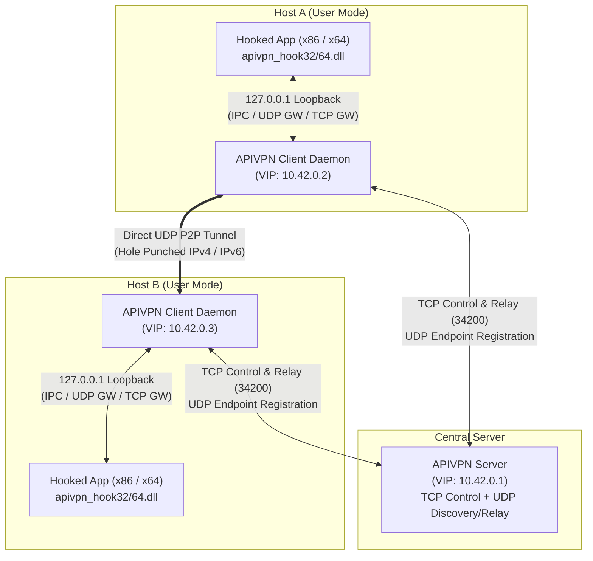
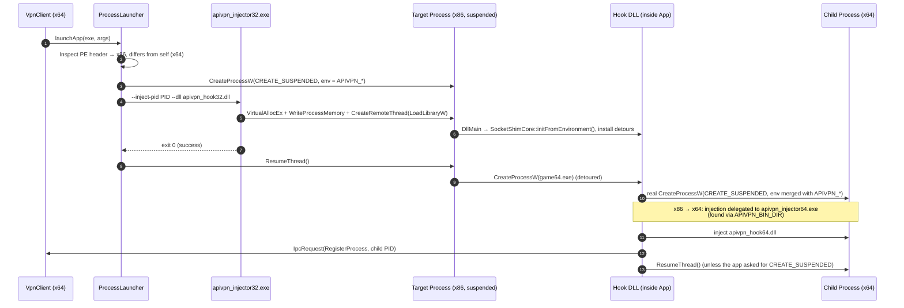
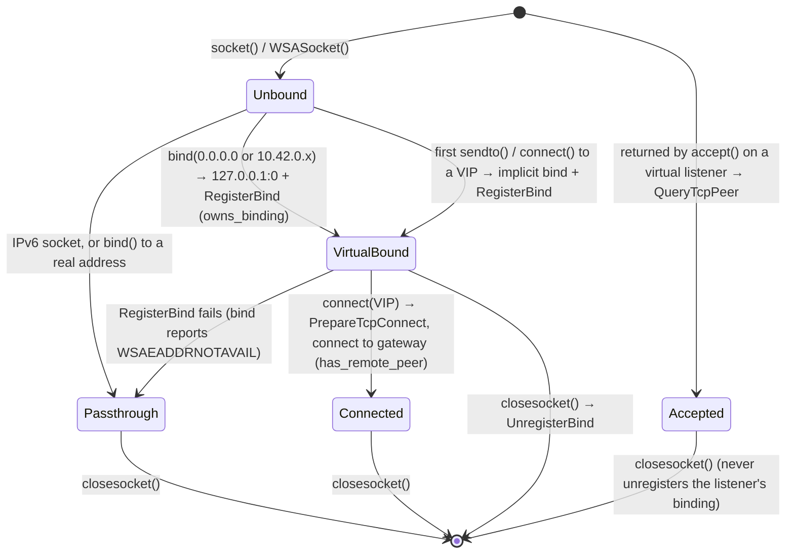
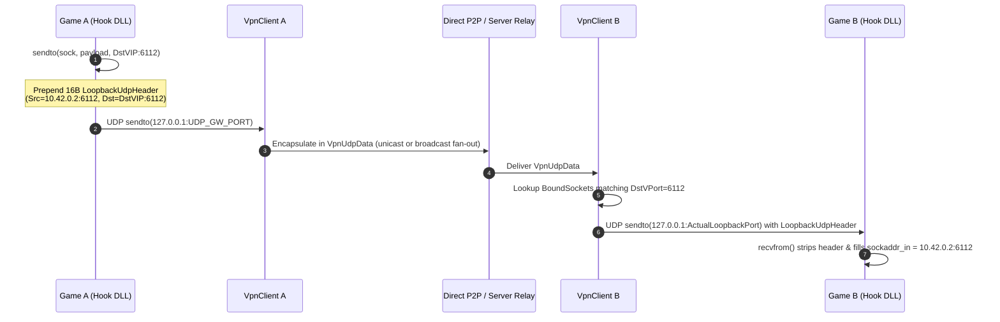
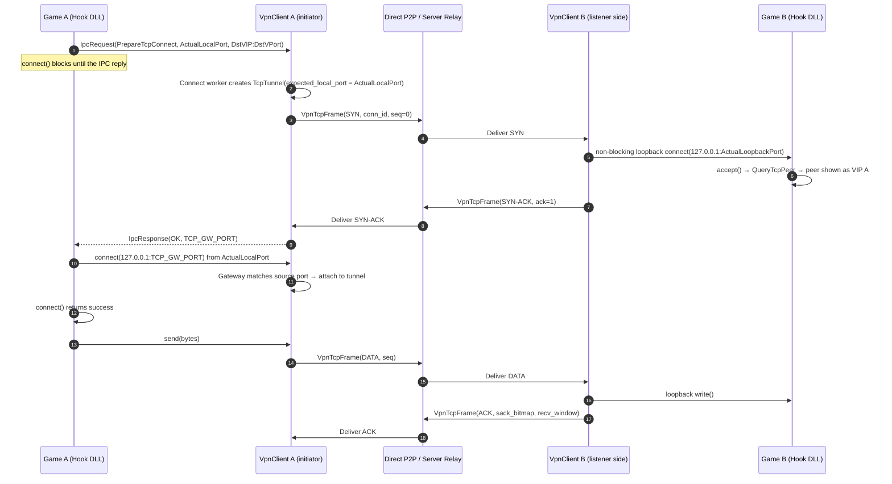
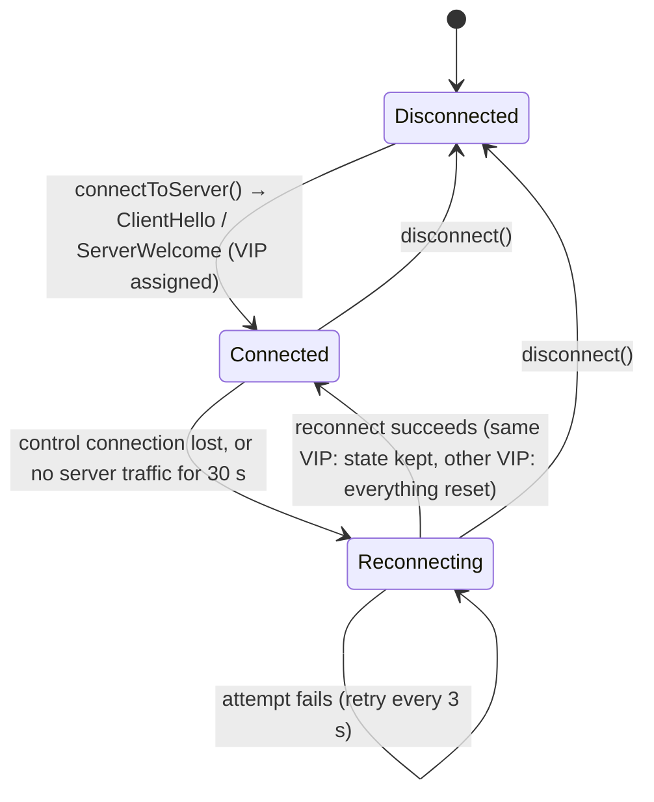
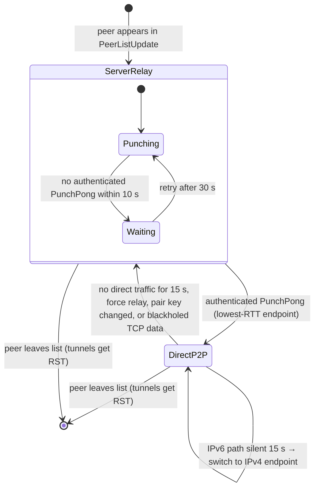
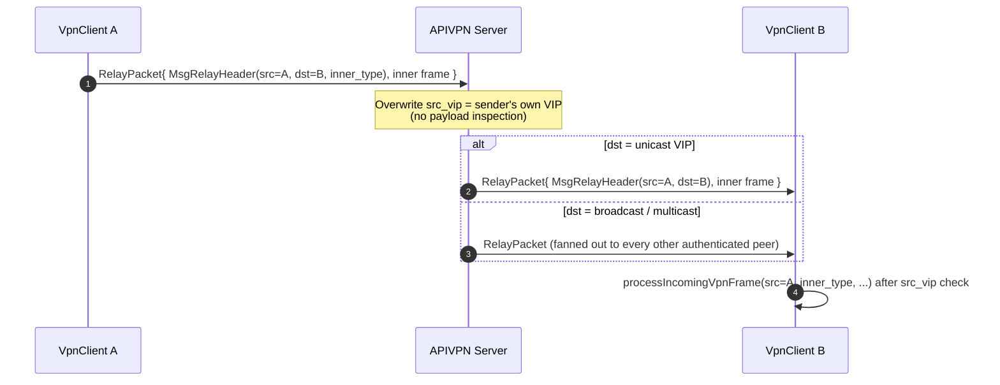

# APIVPN Architecture

**APIVPN** is a user-mode virtual LAN (`10.42.0.0/24`) that enables legacy and classic LAN applications to communicate over the internet without kernel network drivers (such as TAP/Wintun) or administrator privileges. Instead of virtualizing a network interface at the OS level, APIVPN intercepts Winsock, network adapter, and process-creation APIs inside target applications and routes traffic through a local client daemon.

---

## 1. System Overview

APIVPN consists of three primary runtime layers:

1. **Hook Layer (`apivpn_hook32.dll` / `apivpn_hook64.dll`):** Injected into target 32-bit or 64-bit applications. Intercepts socket and adapter APIs and redirects virtual LAN traffic (`10.42.0.0/24`, broadcast, and multicast) to the local client daemon over `127.0.0.1`.
2. **Client Daemon (`apivpn_client.exe`):** Manages local loopback gateways (IPC, UDP, TCP), maintains the virtual network table, performs NAT traversal (UDP hole punching), and multiplexes reliable virtual TCP streams. The same executable hosts the GUI, the tray mode and a headless mode (§2.2).
3. **Coordination & Relay Server (`apivpn_server.exe`):** Allocates Virtual IPs (`10.42.0.2`–`10.42.0.254`), distributes peer endpoint lists, handles lobby chat, and relays frames when direct P2P is unavailable. Builds on Windows and Linux.

### 1.1 Glossary

| Term | Meaning |
| :--- | :--- |
| **VIP** | Virtual IP: the `10.42.0.x` address the server assigns to a client. Every hooked app of that client uses it. |
| **VPort** | Virtual port: the port the app believes it bound or connected to (e.g. `6112`). |
| **ActualPort** | The ephemeral `127.0.0.1` port the hooked socket is really bound to. The client maps `(proto, VPort) ↔ ActualPort`. |
| **Gateway (GW)** | One of the client's loopback listeners: IPC (TCP), UDP gateway, TCP gateway. Their ports reach hooked apps through `APIVPN_*` environment variables. |
| **Tunnel** | A virtual TCP connection (`TcpTunnel`), identified by `conn_id`, carried over the direct path or the relay. |
| **Direct P2P / Server Relay** | The two routes to a peer: hole-punched UDP, or frames wrapped in `RelayPacket` on the server's TCP control connection. |
| **Pair key** | A random 64-bit secret per pair of VIPs, issued by the server, that authenticates direct-path control packets (§5). |
| **Passthrough** | A socket the hook leaves untouched: IPv6, explicitly bound to a real address, or whose virtual bind failed. |

### 1.2 Design Rationale

- **User mode only.** A TAP/Wintun adapter needs a driver install and administrator rights, which the target audience (players of old LAN games on locked-down or shared PCs) often lacks. Hooking inside the app needs neither.
- **Hooked sockets stay real kernel sockets** (bound to `127.0.0.1`) rather than fake handles. `select()`, `WSAPoll()`, `WSAEventSelect()`, `WSAAsyncSelect()`, overlapped I/O and IOCP then keep working without being reimplemented; the hook only rewrites addresses and adds a header.
- **One local daemon per user, not per app.** All hooked processes (including children and both bitnesses) share one VIP, one set of peer routes and one server connection. The hook DLL stays small and has no networking logic beyond loopback.
- **Virtual TCP runs over a custom engine** (§4.3) instead of opening a real TCP connection to the peer. Peers are usually behind NAT, where only hole-punched UDP or the relay can reach them, and both of those are datagram paths.
- **The server relays without inspecting payloads.** It only checks and rewrites the relay header, which keeps it simple and keeps the trust model (§8) easy to state.

---

## 2. Codebase & Module Structure

| Module | Path | Responsibility |
| :--- | :--- | :--- |
| **Common Protocol** | `include/apivpn/common/` | Wire headers, magic constants (`AVP2`, `AVPN`, `AVIP`), byte buffers, logger, and IP helpers. |
| **Platform Layer** | `include/apivpn/platform/` `src/platform/win32/` `src/platform/linux/` | OS abstractions for sockets (`NetSocket`, `pollSockets`, `secureRandom`), PE inspection & process injection (`ProcessLauncher`), x86/x64 inline function detouring (`HookBackend`), and UTF-8 ↔ UTF-16 helpers (`win32_utf8.hpp`). Linux implements `NetSocket` only. |
| **Hook Engine** | `include/apivpn/hook/` `src/hook/` | `SocketShimCore` (portable virtual socket state & IPC client) and `dllmain_win32.cpp` (Win32 API detours). See §3.2. |
| **Injector** | `src/injector/` | `apivpn_injector32.exe` and `apivpn_injector64.exe` helper binaries for cross-bitness `LoadLibraryW` remote-thread injection. |
| **Client** | `include/apivpn/client/` `src/client/` | `VpnClient` core engine, split by concern: `vpn_client_ipc.cpp` (IPC server), `vpn_client_network.cpp` (network worker loop), `vpn_client_gateway.cpp` (UDP gateway), `vpn_client_tcp.cpp` (tunnel engine), `vpn_client_holepunch.cpp` (route management), `vpn_client_process.cpp` (launch and process tracking). Plus `client_main.cpp` (command line) and the Dear ImGui/DX11 front-end (`gui_*.cpp`). |
| **Server** | `include/apivpn/server/` `src/server/` | `VpnServer` single-threaded non-blocking event loop managing VIP assignment, peer discovery, chat, and packet relay. |
| **Tests** | `tests/` | `integration_test_runner.cpp` (end-to-end suite) and `test_game_app.cpp` (the hooked 32/64-bit test app). See [`TESTING.md`](TESTING.md). |

### 2.1 Build Outputs & Deployment Layout

CMake places every binary in `bin/`, and the runtime expects them **side by side** there. The 64-bit build produces the server, client and test runner; the 32-bit build adds the 32-bit hook, injector and test app.

| Binary | Built by | Purpose |
| :--- | :--- | :--- |
| `apivpn_client.exe` | x64 | Client daemon + GUI / tray / headless front-end |
| `apivpn_server.exe` | x64 (Windows), native (Linux) | Coordination & relay server |
| `apivpn_hook64.dll`, `apivpn_injector64.exe` | x64 | Hook and injector for 64-bit targets |
| `apivpn_hook32.dll`, `apivpn_injector32.exe` | x86 | Hook and injector for 32-bit targets |
| `integration_test_runner.exe`, `test_game_app32/64.exe` | x64 / x86 | Test suite |

The client finds hooks and injectors in its own directory and passes that directory to hooked apps as `APIVPN_BIN_DIR`, so a hook running inside a game installed elsewhere can still find the DLL and injector for a child of the other bitness. All binaries link their C/C++ runtime statically (`/MT` or `-static`), so an injected hook brings no runtime DLL into the game process. Windows builds target Windows 10 (`_WIN32_WINNT=0x0A00`).

### 2.2 Platform Support & Client Front-Ends

- **Windows:** everything. **Linux:** the server only (`src/platform/linux/README.md` sketches what an `LD_PRELOAD` client would need).
- **`apivpn_client.exe` modes** (all wrap one `VpnClient`):
  - **GUI** (default): Dear ImGui on DirectX 11. The UI thread reads state through `VpnClient::getSnapshot()` every frame and never touches client internals directly. Connecting runs on a background thread so the window stays responsive.
  - **Tray** (`--tray`, or when started minimized, or when a game is given on the command line): the same GUI hidden behind a notification-area icon.
  - **Headless** (`--headless`): no window. Connects, optionally launches a game once a VIP is assigned (waiting up to 30 s), and exits when the game ends or the connection stops.
- **Configuration:** `apivpn_client.ini` next to the executable holds the server, port, nickname, `force_relay`, recent servers and saved game profiles. Command-line options override it.

---

## 3. Process Injection & Cross-Bitness Propagation

Games frequently use a 32-bit launcher that spawns a 64-bit game executable (or vice versa). APIVPN handles this transparently:

1. **Environment Configuration:** `VpnClient` passes session parameters to launched processes via environment variables (`APIVPN_VIP`, `APIVPN_IPC_PORT`, `APIVPN_UDP_GW_PORT`, `APIVPN_TCP_GW_PORT`, `APIVPN_TOKEN`, `APIVPN_BIN_DIR`). They go into an explicit Unicode environment block passed to `CreateProcessW`; the client's own environment is never modified. A launch requires an assigned Virtual IP, so `launchApp` fails while the client is not connected. All paths and arguments are UTF-8 internally and cross the Win32 boundary through the W APIs, so non-ASCII install and game paths work.
2. **PE Architecture Detection:** `ProcessLauncher` inspects the target executable's PE header (`IMAGE_FILE_MACHINE_I386` vs `IMAGE_FILE_MACHINE_AMD64`).
3. **Suspended Launch & Injection:** The target process is created with `CREATE_SUSPENDED`. If the target has the same bitness as the injecting process, `ProcessLauncher` injects directly: it writes the DLL path into the target with `VirtualAllocEx` + `WriteProcessMemory` and runs `LoadLibraryW` via `CreateRemoteThread`. Otherwise it runs the matching helper (`apivpn_injector32.exe` or `apivpn_injector64.exe`), which does the same from the right bitness. Each step waits at most 10 s. The main thread is resumed only after the DLL has loaded; if injection fails, the process is terminated and the launch fails.
4. **Child Process Propagation:** The hook DLL detours `CreateProcessA`, `CreateProcessW`, and the lower-level `CreateProcessInternalW`. It forces `CREATE_SUSPENDED`, injects the child with the same logic as step 3, reports the new PID to `VpnClient` via `IpcCommand::RegisterProcess`, and resumes the child only if the caller did not ask for a suspended start. If the caller passes its own environment block, the `APIVPN_*` variables are merged into it. Injection fails closed: if it fails (or times out; the remote path buffer is then deliberately leaked because `LoadLibraryW` may still be reading it), the child is terminated and `CreateProcess` fails with `ERROR_ACCESS_DENIED`, rather than letting the child run un-hooked on the real network.
5. **Single-Instance Isolation:** DirectPlay helper named kernel objects are namespaced per client by rewriting their names — covering both the `Create*` and matching `Open*` variants (`CreateEventExW`/`OpenEventW`, `CreateMutexExW`/`OpenMutexW`, `CreateFileMappingNumaW`/`OpenFileMappingW`) — so multiple instances of the same game can run simultaneously on one PC. `LoadLibraryExW` is additionally detoured to block DirectPlay's in-process NAT helper library, and `AttachConsole` is detoured to stop hooked applications from taking over the client's console.

### 3.1 Hooked API Surface

The hook DLL installs the following detours (`HookBackend::installDetour`, resolved by `GetProcAddress`):

| DLL | Detoured APIs | Purpose |
| :--- | :--- | :--- |
| `ws2_32.dll` | `socket`, `WSASocketA/W`, `closesocket`, `bind`, `getsockname`, `getpeername`, `sendto`, `WSASendTo`, `recvfrom`, `WSARecvFrom`, `send`, `WSASend`, `recv`, `WSARecv`, `connect`, `WSAConnect`, `accept`, `WSAAccept`, `gethostbyname`, `getaddrinfo`, `WSAIoctl`, `WSAGetOverlappedResult` | Virtual socket binding, loopback gateway redirection, adapter/DNS virtualization, overlapped-completion fix-up |
| `iphlpapi.dll` | `GetAdaptersInfo`, `GetAdaptersAddresses` | Synthesize the virtual LAN adapter |
| `kernelbase.dll` (falling back to `kernel32.dll`) | `GetOverlappedResult(Ex)`, `GetQueuedCompletionStatus(Ex)` | Overlapped / IOCP completion fix-up for virtualized UDP sockets (§4.2) |
| `kernelbase.dll` | `CreateProcessInternalW`, `LoadLibraryExW`, `CreateEventExW`/`OpenEventW`, `CreateMutexExW`/`OpenMutexW`, `CreateFileMappingNumaW`/`OpenFileMappingW` | Child-process propagation, DirectPlay NAT-helper blocking, per-instance object isolation |
| `kernel32.dll` | `CreateProcessA/W`, `AttachConsole` | Child-process propagation, console takeover prevention |

> The injector helper processes (`apivpn_injector32/64.exe`) are explicitly excluded from child-process injection to avoid recursive hooking.

**Failing closed.** Every `orig_*` pointer is resolved with `GetProcAddress` before patching, so it is never null. The Winsock socket and data detours are *required*: if any of them fails to install, the shim never initializes and every detour passes straight through, so the app runs un-virtualized rather than half-virtualized. If a completion detour is missing, only event/IOCP overlapped UDP receives lose the fix-up and pass through unchanged; completion-routine I/O still works. The iphlpapi, DirectPlay and process detours are optional and only logged. Diagnostics go to `OutputDebugString` with an `[apivpn-hook]` prefix.

### 3.2 Hook DLL Internals

The hook is split into two layers so that the bookkeeping can be reused by a future non-Windows hook:

- **`SocketShimCore`** (`socket_shim_core.cpp`, portable): a process-wide singleton holding the session parameters read from the environment, a map from socket handle to `VirtualSocketState`, the IPC client, and a 1-second cache for `QueryBind` answers. Each IPC call opens a fresh loopback TCP connection to `APIVPN_IPC_PORT`, sends one `IpcRequest` and reads one `IpcResponse`. The socket calls go through a raw exchange function supplied by the Win32 layer, so they bypass the detours.
- **`dllmain_win32.cpp`** (Win32): the detours themselves, the overlapped-I/O records, adapter/DNS synthesis and process propagation. It decides per call whether a socket is virtual and rewrites addresses and buffers accordingly.

**Detour engine** (`inline_detour_win32.cpp`). It copies the first instructions of the target function into an executable trampoline and overwrites them with a jump to the detour. It decodes an explicit, documented subset of x86/x64 instructions and relocates RIP-relative operands. It refuses to hook anything it does not recognise, any prologue with a branch back into the stolen bytes, and any relocation out of `rel32` range. It patches with all other threads suspended, refusing if one of them is executing the bytes being replaced.

**Socket state.** Each socket the app creates gets a `VirtualSocketState`. The flags that drive the detours move like this:

**Concurrency inside the app.** Detours run on whatever thread the app calls from, often several at once.

- `SocketShimCore::mutex_` guards the socket map and the bind cache. Fields are changed only through `modifySocketState`, which applies the change under the lock, so two threads updating one socket cannot overwrite each other. IPC and Winsock calls are never made while it is held.
- `g_implicit_bind_mutex` serializes implicit binds, so two threads sending on the same unbound socket cannot both bind it.
- `g_ovl_mutex` guards the per-`OVERLAPPED` records (§4.2), so the fix-up happens exactly once however many completion APIs observe it.
- A thread-local bypass flag (`ScopedHookBypass`) lets the hook call Winsock itself without re-entering its own detours. `gethostbyname` results live in thread-local storage, as Winsock's own do.

---

## 4. Loopback Socket Virtualization

Hooked sockets are **real OS kernel sockets** bound to `127.0.0.1` on OS-assigned ephemeral ports (`0`). Keeping real kernel descriptors preserves full compatibility with `select()`, `WSAPoll()`, `WSAEventSelect()`, `WSAAsyncSelect()`, and Overlapped I/O.

### 4.1 Virtual Port Binding (`bind`)
When a hooked application binds a UDP or TCP socket to `0.0.0.0:<VPort>` or `10.42.0.x:<VPort>`:
1. The hook rewrites the `bind()` address to `127.0.0.1:0`, receiving an ephemeral loopback port `<ActualPort>`.
2. The hook sends an `IpcCommand::RegisterBind` request over loopback TCP to `VpnClient` (`APIVPN_IPC_PORT`), mapping `(Proto, VPort) <-> ActualPort`.
3. Calls to `getsockname()` return `LocalVIP:VPort` to the application.
4. Only the socket that issued `RegisterBind` sends `UnregisterBind` when it closes (`VirtualSocketState::owns_binding`). Sockets returned by `accept()` share the listener's ports but never own the binding, so closing an accepted connection cannot unregister its listener.

Sockets the application binds explicitly to a real address (e.g. `127.0.0.1` or a NIC address) are marked *passthrough* and never virtualized. Traffic to `127.0.0.1` is only routed through the virtual LAN when it targets a port bound by a hooked socket of this client (checked with `IpcCommand::QueryBind`, cached for 1 s); otherwise `sendto()` and `connect()` go to the real local service. Only IPv4 sockets are virtualized; IPv6 sockets pass through.

### 4.2 UDP Unicast, Broadcast & Multicast Data Path
Every virtual UDP datagram exchanged between a hooked socket and `VpnClient`'s local UDP gateway (`APIVPN_UDP_GW_PORT`) is prefixed with a 16-byte `LoopbackUdpHeader` (`Magic="AVPN" | SrcVIP | DstVIP | SrcVPort | DstVPort`).

Receive semantics follow Winsock. A datagram larger than the app's buffer fills the buffer with the truncated payload and fails with `WSAEMSGSIZE` (`MSG_PARTIAL` for `WSARecvFrom`), and `MSG_PEEK` strips the header without consuming the datagram. Datagrams that did not come from the UDP gateway are delivered unchanged, with their real source.

**Overlapped I/O.** Overlapped and completion-routine `WSARecvFrom`/`WSASendTo` on virtualized UDP sockets use scatter/gather: `WSABUF[0]` is a 16-byte header slot in a per-operation record, keyed by the `OVERLAPPED`, followed by the app's buffers. The completion is fixed up exactly once: the byte count drops by 16, the virtual source is written, and `OVERLAPPED::InternalHigh` is rewritten. This happens either immediately, or in whichever of the wrapped completion routine, `WSAGetOverlappedResult`, `GetOverlappedResult(Ex)` or `GetQueuedCompletionStatus(Ex)` observes the completion first. Known limitations: apps that read `InternalHigh` before calling any of those functions, and thread-pool I/O (`CreateThreadpoolIo`).

### 4.3 Virtual TCP Stream Multiplexing
Because VPN peer links operate over UDP (or framed TCP relay), `VpnClient` implements a user-space reliable stream engine (`TcpTunnel`) for virtual TCP connections.

**Outgoing `connect(DstVIP:DstVPort)`:**
1. The hook binds the application socket to `127.0.0.1:0` (`<ActualLocalPort>`) if it is not bound yet.
2. The hook sends `IpcCommand::PrepareTcpConnect` with `ActualLocalPort`, `DstVIP` and `DstVPort`, and **blocks the app's `connect()` until the reply**. The IPC thread hands the request to one of four connect workers, so a slow handshake cannot stall other processes' IPC. The worker creates a `TcpTunnel` with `expected_local_port = ActualLocalPort`, sends `VpnTcpFrame(SYN)` and waits for `SYN-ACK`. It retransmits the SYN every 200 ms (from the second retransmission on, via the relay) and gives up after about 2.4 s.
3. On success the reply carries the TCP gateway port; on failure `connect()` fails with `WSAECONNREFUSED`.
4. The hook connects the app socket to `127.0.0.1:TCP_GW_PORT`. Even for a non-blocking socket it waits for this loopback handshake (well under a millisecond) and returns success, because callers such as DirectPlay treat the socket as connected immediately.
5. **Gateway matching:** the TCP gateway accepts the connection and attaches it to the unattached tunnel whose `expected_local_port` equals the connection's **source port**. Because the hook bound the socket to `ActualLocalPort` before connecting, the source port identifies the tunnel without any extra handshake. A connection that matches no tunnel is dropped, and a tunnel the app never attaches to is reaped after `kTcpTunnelAttachTimeoutUs`.

From then on `send()`/`recv()` stream raw bytes directly between the game and `VpnClient`.

**Connecting to the client's own VIP.** If `DstVIP` is the client's own VIP (or `127.0.0.1` with a hooked listener), no tunnel is created: the reply carries the listener's `ActualPort` and the hook connects straight to it. The client records the caller's virtual address so the listener's `accept()` can report it.

**Incoming `accept()` on a Listener:**
1. When `VpnClient` receives a remote `VpnTcpFrame(SYN)` for a registered listening `DstVPort`, it opens a non-blocking loopback TCP connection from a bridge socket to the game's `ActualLoopbackPort` and records `bridge port → (RemoteVIP, RemoteVPort)`. It answers `SYN-ACK` from the tunnel pump loop once that connection completes, so the shared network worker never blocks.
2. When the game calls `accept()` or `getpeername()`, the hook queries `VpnClient` (`IpcCommand::QueryTcpPeer`) with the accepted socket's peer port (the bridge port) and rewrites the peer address to `RemoteVIP:RemoteVPort`.

**Engine properties:**
* **Reliability & Congestion Control:** `TcpTunnel` segments streams into 1200-byte chunks (`kMaxTcpSegmentPayload`) with cumulative ACKs, a 64-segment selective-ACK bitmap (`sack_bitmap`), RFC 6298 RTT estimation, fast retransmit, and AIMD congestion window scaling. Sequence/ACK comparisons use wrap-safe serial-number arithmetic. An established tunnel that goes silent past `kTcpTunnelIdleTimeoutUs` is aborted like any other failure (below), so a dead peer cannot leak loopback sockets or receive buffers. Both directions emit lightweight liveness probes every `kTcpTunnelKeepAliveIntervalUs`, also after sending their FIN, so an idle or half-closed tunnel to a live peer is never reaped.
* **Tunnel identity:** `conn_id` is 24 random bits (OS CSPRNG) plus the initiator's VIP low byte. A frame is processed only if its `src_vip`/`src_vport` match the tunnel's remote end; others are dropped silently, so one peer cannot reset or inject into another peer's connection.
* **Resource bounds:** in-order data that would push the per-tunnel buffer past `kMaxTcpRecvBufBytes` is dropped without an ACK, the out-of-order store is bounded by segments and bytes, and payloads over `kMaxTcpSegmentPayload` are rejected. Each peer can have at most `kMaxTcpTunnelsPerPeer` tunnels and the client at most `kMaxTcpTunnelsTotal`; excess SYNs get RST.
* **Failure semantics:** a local socket error, `kMaxTcpSegmentRetransmits` unacknowledged retransmissions, the idle timeout, a peer RST, or the peer leaving the peer list aborts the tunnel. The peer gets an RST where a path exists, and the local app gets an abortive close (`SO_LINGER {1,0}`), so it sees a connection reset rather than an EOF that looks like a complete stream.
* **Blackholed direct path:** if a tunnel's data has never been acknowledged over the direct path and it hits three consecutive retransmission timeouts, the peer's route is switched to the relay.

### 4.4 Network Adapter & DNS Virtualization
To ensure games discover the virtual LAN interface and broadcast address:
* `GetAdaptersInfo`, `GetAdaptersAddresses`, and `WSAIoctl(SIO_GET_INTERFACE_LIST)` synthesize or rewrite the primary adapter to `10.42.0.x` with netmask `255.255.255.0`.
* `gethostbyname` and `getaddrinfo` resolve the local hostname to the client's assigned `10.42.0.x` Virtual IP.

---

## 5. WAN Transport: Discovery, Hole Punching & Relay

`VpnClient` keeps one server connection and, for every peer, a `PeerState` with its own route. These are two separate state machines.

**Server connection** (one per client):

**Route to one peer** (`RouteMode` is `ServerRelay` or `DirectP2P`; hole punching is an activity while on the relay, not a separate mode):

### Routing Lifecycle
1. **Session Handshake (TCP):** Client connects to `VpnServer` and sends `ClientHello` (containing its nickname, local LAN IPv4/IPv6 endpoints, and optional previous session token). Server responds with `ServerWelcome` (`assigned_vip`, `session_token`, `server_udp_port`).
2. **External NAT Discovery (UDP):** Client sends `UdpRegister` to `server_udp_port`. The server records the client's observed public IP:port alongside its self-reported LAN endpoints and broadcasts `PeerListUpdate` to all connected clients.
3. **Simultaneous UDP Hole Punching:** For every discovered peer, traffic flows via `ServerRelay` immediately, while the client probes all candidate IPv4 and IPv6 endpoints with `PunchPing` / `PunchPong`.
4. **Direct P2P Upgrade & Fallback:** Upon receiving an authenticated `PunchPong`, the peer route switches to `DirectP2P` using the lowest-RTT endpoint. Idle tunnels exchange `KeepAlive` probes every 5 seconds and automatically fall back to `ServerRelay` if no direct traffic arrives within 15 seconds.
5. **Server Outage:** If the control connection drops, peers on a verified `DirectP2P` route, their TCP tunnels and the client's VIP are kept (direct keep-alives continue), while relay-only peers are dropped. DNS and reconnect run on a helper thread, so the network worker never blocks. A `ServerWelcome` with a different VIP resets everything. A restarted server issues new pair keys, which resets kept tunnels when its first peer list arrives.

### Direct-Path Authentication (Pair Keys)

The server keeps a random 64-bit key (OS CSPRNG) for every unordered pair of VIPs and sends each client a **personalized** `PeerListUpdate`: the entry for peer P sent to recipient R carries `pair_key = key(R, P)`. Keys involving a VIP are discarded when that VIP is handed to a different client, so a new holder never inherits the old holder's keys. A reconnect that reclaims its VIP with the same session token keeps them.

* Every `PunchPing`, `PunchPong` and `KeepAlive` carries the pair key for `(src_vip, dst_vip)`. Packets with an unknown sender, a foreign `dst_vip`, or a missing or wrong key are dropped without a reply.
* Only authenticated packets can set or switch a peer's active endpoint or add a peer-reflexive candidate.
* Direct `VpnUdpData` / `VpnTcpFrame` are accepted only from the claimed peer's verified endpoint. Data never upgrades a route by itself.
* A changed key for a VIP means a different client now holds it: that peer's direct route is reset and its tunnels get RST.

This defeats off-path spoofing and impersonation by other peers. It is not cryptographic: the key travels in plaintext, so an on-path observer can still forge packets (§8).

### Server Relay Data Path

When direct P2P is unavailable, `VpnClient` wraps each `VpnUdpData` / `VpnTcpFrame` in a `MsgRelayHeader` and forwards it over the existing TCP control channel:

The server never inspects the inner frame; it only validates the `MsgRelayHeader` bounds, overwrites `src_vip` with the sending session's authenticated VIP, and delivers to the matching unicast VIP or fans out to all other peers for broadcast/multicast destinations.

---

## 6. Wire Protocols Summary

All protocol structures are packed (`#pragma pack(push, 1)` in `include/apivpn/common/protocol.hpp`) and sent with `memcpy`, so **multi-byte fields are in the sender's native byte order: little-endian** on every supported target (x86, x64, x86-64 Linux). Only `EndpointWire::addr` is in network order. A big-endian port would need explicit conversion.

| Protocol | Transport | Magic | Header / Commands |
| :--- | :--- | :---: | :--- |
| **Local IPC** | Loopback TCP (`127.0.0.1:ipc_port`), one request per connection | `AVIP` (`0x41564950`) | `IpcRequest` / `IpcResponse`: `RegisterBind`, `UnregisterBind`, `PrepareTcpConnect`, `QueryTcpPeer`, `RegisterProcess`, `QueryBind` |
| **Local UDP Gateway** | Loopback UDP (`127.0.0.1:udp_gw_port`) | `AVPN` (`0x4156504E`) | `LoopbackUdpHeader` (16B) + raw UDP payload |
| **Server Control & Relay** | WAN TCP (Default `34200`) | `AVP2` (`0x41565032`) | `ControlHeader` (9B): `ClientHello`, `ServerWelcome`, `PeerListUpdate` (per-recipient `PeerEntryWire::pair_key`), `ChatMessage`, `RelayPacket`, `Ping/PongKeepalive` |
| **WAN UDP Transport** | WAN UDP (Server `34200` & Ephemeral Peer Ports) | `AVP2` (`0x41565032`) | `UdpWireHeader` (5B): `UdpRegister`, `UdpRegAck`, `PunchPing` / `PunchPong` / `KeepAlive` (`UdpPunchPacket`, carries `pair_key`), `VpnUdpData`, `VpnTcpFrame` |

The magic was bumped from `AVP1` when `pair_key` was added, so older and newer builds reject each other's frames instead of misparsing them. Clients and server must be upgraded together.

### 6.1 Message Layouts

Sizes in bytes. `u8/u16/u32/u64` are little-endian unsigned integers. The struct named in each heading is the authoritative definition.

**`ControlHeader`** (9) — prefix of every TCP control message:

| Field | Type | Notes |
| :--- | :--- | :--- |
| `magic` | u32 | `AVP2` |
| `type` | u8 | `ClientHello=1`, `ServerWelcome=2`, `PeerListUpdate=3`, `ChatMessage=4`, `RelayPacket=5`, `PingKeepalive=6`, `PongKeepalive=7` |
| `payload_len` | u32 | Bytes following the header |

**Control payloads:**

| Message | Layout |
| :--- | :--- |
| `MsgClientHello` | `nickname[32]`, `udp_listen_port` u16, `udp_listen_port_v6` u16, `local_ep_count` u8, `local_endpoints[16]` (`EndpointWire`), `preferred_vip` u32, `prev_session_token` u64 |
| `MsgServerWelcome` | `assigned_vip` u32, `session_token` u64, `server_udp_port` u16 |
| `PeerListUpdate` | `MsgPeerListHeader` (`peer_count` u16), then `peer_count` × `PeerEntryWire`: `vip` u32, `nickname[32]`, `endpoint_count` u8, `endpoints[16]`, `pair_key` u64 |
| `ChatMessage` (`MsgChat`) | `sender_vip` u32, `sender_name[32]`, `text_len` u16, then `text_len` bytes of UTF-8 |
| `RelayPacket` (`MsgRelayHeader`) | `src_vip` u32, `dst_vip` u32, `inner_type` u8 (`VpnUdpData` or `VpnTcpFrame`), `data_len` u16, then the inner frame |
| `EndpointWire` (19) | `family` u8 (4 or 6), `addr[16]` (network order; IPv4 uses the first 4), `port_host` u16 |

**`UdpWireHeader`** (5) — prefix of every WAN UDP datagram: `magic` u32 (`AVP2`), `type` u8 (`UdpRegister=10`, `UdpRegAck=11`, `PunchPing=12`, `PunchPong=13`, `KeepAlive=14`, `VpnUdpData=20`, `VpnTcpFrame=30`).

| Packet | Layout after `UdpWireHeader` |
| :--- | :--- |
| `UdpRegisterPacket` | `src_vip` u32, `session_token` u64 |
| `UdpPunchPacket` (PunchPing / PunchPong / KeepAlive) | `src_vip` u32, `dst_vip` u32, `timestamp_us` u64, `pair_key` u64 (0 is never valid) |
| `VpnUdpDataHeader` | `src_vip` u32, `dst_vip` u32, `src_vport` u16, `dst_vport` u16, `payload_len` u16, then the payload |
| `VpnTcpFrameHeader` (37) | `conn_id` u32, `src_vip` u32, `dst_vip` u32, `src_vport` u16, `dst_vport` u16, `flags` u8 (`Syn=0x01`, `SynAck=0x02`, `Data=0x04`, `Ack=0x08`, `Fin=0x10`, `Rst=0x20`), `seq_num` u32, `ack_num` u32 (next expected), `sack_bitmap` u64 (bit *i* = segment `ack_num+1+i` received), `recv_window` u16 (segments), `payload_len` u16, then the payload |

Over the relay, `VpnUdpData` and `VpnTcpFrame` travel as the inner frame of `RelayPacket`, without a `UdpWireHeader`.

**Local protocols:**

| Struct | Layout |
| :--- | :--- |
| `LoopbackUdpHeader` (16) | `magic` u32 (`AVPN`), `src_vip` u32, `dst_vip` u32, `src_vport` u16, `dst_vport` u16 |
| `IpcRequest` (20) | `magic` u32 (`AVIP`), `command` u8, `proto` u8 (`Udp=1`, `Tcp=2`), `virtual_port` u16, `actual_loopback_port` u16, `target_vip` u32, `target_vport` u16, `pid` u32 |
| `IpcResponse` (13) | `magic` u32, `status` u8 (0 = OK), `assigned_vport` u16 (for `PrepareTcpConnect`: port to connect to), `peer_vip` u32, `peer_vport` u16 |

---

## 7. Constants, Ports & Limits

Values are grouped by the file that defines them; that file is authoritative if this table and the code disagree. Server abuse limits (per-IP caps and rate limits) are policy rather than protocol and are listed in §8.

**Shared protocol constants** (`include/apivpn/common/protocol.hpp`):

| Constant | Value | Meaning |
| :--- | :--- | :--- |
| `kVirtualSubnetBase` / `kVirtualSubnetMask` | `10.42.0.0` / `255.255.255.0` | Virtual LAN subnet (`/24`) |
| Virtual IP range | `10.42.0.2` – `10.42.0.254` | Assignable client VIPs (`.1` = server, `.255` = broadcast) |
| `kDefaultServerPort` | `34200` | TCP control + UDP transport/relay port |
| `kMaxPacketSize` | `65507` | Maximum UDP datagram size |
| `kMaxNicknameLen` | `32` | Nickname length |
| `kMaxEndpointsPerPeer` | `16` | Advertised candidate endpoints per peer |
| `kHolePunchTimeoutUs` | `10 s` | Hole-punch attempt window |
| `kHolePunchRetryIntervalUs` | `30 s` | Periodic hole-punch retry while on Server Relay |
| `kTunnelKeepAliveIntervalUs` | `5 s` | Idle direct-path keep-alive |
| `kTunnelKeepAliveTimeoutUs` | `15 s` | Direct-path inactivity timeout → relay fallback |
| `kServerKeepAliveIntervalUs` | `5 s` | Client → server keep-alive ping |
| `kServerPeerTimeoutUs` | `30 s` | Peer/server inactivity timeout |
| `kServerReconnectIntervalUs` | `3 s` | Server reconnect attempt interval |
| `kMaxTcpSegmentPayload` | `1200` | Virtual TCP segment payload (mobile/NAT safe) |
| `kMaxTcpWindowSegments` | `2048` | Maximum in-flight window (~2.4 MB) |
| `kMaxTcpRecvBufBytes` | `4 MB` | Per-tunnel receive buffer |
| `kTcpTunnelKeepAliveIntervalUs` | `15 s` | Idle virtual-TCP tunnel liveness probe |
| `kTcpTunnelIdleTimeoutUs` | `60 s` | Silent established tunnel is reaped |
| `kTcpTunnelBridgeConnectTimeoutUs` | `3 s` | Budget for the loopback connect to a local listening app |
| `kTcpZeroWindowProbeIntervalUs` | `200 ms` | Probe cadence while the peer advertises a zero window |

**Client** (`include/apivpn/client/vpn_client.hpp`):

| Constant | Value | Meaning |
| :--- | :--- | :--- |
| `kMaxTcpTunnelsPerPeer` / `kMaxTcpTunnelsTotal` | `256` / `1024` | Virtual TCP tunnel caps per peer / per client |
| `kTcpTunnelAttachTimeoutUs` | `30 s` | Outgoing tunnel the app never attaches to is reaped |
| `kMaxTcpSegmentRetransmits` | `30` | Retransmissions before a tunnel is aborted with RST |
| `kMaxServerSendBufBytes` | `8 MB` | Client's queue toward the server; relayed frames drop above it |
| `kMaxChatHistoryMessages` | `500` | Client chat history cap, oldest dropped |

Virtual-TCP congestion-control defaults (`TcpTunnel`): initial `cwnd` = 64 segments, initial `ssthresh` = 512 segments, initial `rto` = 200 ms (RFC 6298, clamped to 20 ms – 2 s).

**Server** (`include/apivpn/server/vpn_server.hpp`, `src/server/vpn_server.cpp`):

| Constant | Value | Meaning |
| :--- | :--- | :--- |
| `VpnServer::max_clients_` | `253` | Concurrent authenticated clients |
| `kMaxSessionSendBufBytes` (+2 MB control headroom) | `8 MB` | Per-session send queue; relay frames drop above it, exceeding the hard cap disconnects |
| `kVipReservationUs` | `60 s` | VIP held for a disconnected client's session token |
| `kHelloDeadlineUs` | `10 s` | New connection must send `ClientHello` |
| `kPeerListMinIntervalUs` | `250 ms` | Minimum interval between peer-list broadcasts |
| `kObservedEndpointTtlUs` | `60 s` | Expiry of UDP-observed peer endpoints |

---

## 8. Security & Trust Model

APIVPN targets trusted peer groups playing LAN games; it is **not** a confidentiality or privacy tool.

* **No transport encryption.** All virtual LAN payloads (UDP datagrams and virtual TCP segments) travel in plaintext on both the direct P2P path and the Server Relay. Anyone observing the underlying UDP/TCP traffic can read it.
* **Direct-path source checks, not cryptographic authentication.** Peers are identified by the Virtual IP assigned by the server. On the direct path, per-pair keys (§5) stop off-path hosts and other peers from claiming a VIP or moving a route, but the keys travel in plaintext. An on-path attacker can read them and forge or alter traffic.
* **Server-issued session token.** `ClientHello` carries a server-generated `session_token` (returned in `ServerWelcome`), used to reclaim a previous VIP on reconnect via `prev_session_token`. Tokens come from the OS CSPRNG, and `UdpRegister` is rate-limited per source IP, so tokens cannot be guessed or brute-forced through the UDP ack. A disconnected client's VIP is reserved for its token for 60 seconds, so no one else can take it during a brief outage. The token is a session-continuity mechanism, not an access credential: the server accepts any client that connects.
* **Relay source-address enforcement.** The relay server overwrites `MsgRelayHeader::src_vip` with the sending session's own VIP before forwarding, so a client cannot spoof another peer's source address through the relay. Virtual TCP frames are additionally bound to their tunnel's remote VIP and port.
* **Server resource limits.** The server is internet-facing, so it enforces:
  * a cap on total sessions (`max_clients_`, plus 64 unauthenticated connections of headroom);
  * per-IP caps of 24 connections and 16 authenticated clients, with loopback exempt (`VpnServer::setMaxConnectionsPerIp` / `setMaxClientsPerIp`);
  * a 10-second deadline for a new connection to send `ClientHello`;
  * a hard cap on each session's send queue, which also covers control messages (a client that stops reading is disconnected, and a queue that makes no progress for the inactivity timeout disconnects too);
  * peer-list broadcasts coalesced to at most one per 250 ms;
  * rate limits: `UdpRegister` 20/s (burst 40) per source IP; per session, chat 32 KB/s (burst 128 KB) and relayed broadcast/multicast 512 KB/s (burst 1 MB);
  * rate-limited warnings (one per 10 s) and sanitized nicknames in logs.

  On Windows, listening sockets use `SO_EXCLUSIVEADDRUSE`, so no other process can bind the server's ports.
* **Local IPC is unauthenticated loopback.** Hooked processes talk to the local client daemon over `127.0.0.1` TCP with no credentials; isolation relies on the OS loopback boundary and the per-run ephemeral gateway ports passed via environment variables.
* **Local privilege.** The client, injector, and hook DLL all run at the target application's privilege level with no Administrator rights and no kernel components.

Potential hardening (not implemented today): end-to-end payload encryption and integrity (e.g. a Noise/DTLS-style handshake keyed by the pair key, which would also stop on-path forgery), cryptographic peer identity, and authenticated local IPC.

---

## 9. Concurrency Model

### 9.1 Client (`VpnClient`)

| Thread | Started by | Does |
| :--- | :--- | :--- |
| `network_thread_` | `initLocalGateways()` | Polls the UDP gateway, TCP gateway listener, IPv4/IPv6 transport sockets, the server connection and every tunnel's local socket (1 ms timeout while tunnels exist, else 5 ms). Then, holding `mutex_`, it handles everything that is ready: the gateways, the transport, server messages, tunnel pumping, hole punching, keep-alives and timeouts. |
| `ipc_thread_` | `initLocalGateways()` | Accepts IPC connections and answers each request under `mutex_`. Passes remote `PrepareTcpConnect` requests to the connect workers instead of handling them inline. |
| `ipc_connect_workers_` (4) | `initLocalGateways()` | Each takes one remote connect: creates the tunnel and sends SYN under `mutex_`, then waits on `cv_` (which releases `mutex_`) for the handshake, and writes the IPC reply. |
| `reconnect_thread_` | network thread, on server loss | Resolves DNS and opens the TCP connection to the server, then hands the socket back under `mutex_`. The network thread adopts it on its next tick, so DNS never stalls the data path. A generation counter discards results that arrive after `disconnect()`. |
| Caller / GUI threads | — | Public API (`connectToServer`, `launchApp`, setters, `getSnapshot`). Simple flags are atomics; everything else takes `mutex_`. |

Rules that keep this safe:

- **One big lock.** `mutex_` guards peers, tunnels, bindings, process tracking and chat history. It is held for short, non-blocking sections only; nothing waits on the network while holding it, and the poll itself runs outside it.
- **Only the network thread closes polled sockets.** Other threads hand sockets to `retireSocket()`, and the network thread closes them between polls. This prevents a handle being closed (and reused by the OS) while it is in the poll set.
- **Handshake completion is signalled.** The network thread notifies `cv_` when a SYN-ACK or RST arrives, which wakes the waiting connect worker.

### 9.2 Server (`VpnServer`)

`start()` launches one `worker_thread_` that runs the whole server as a non-blocking poll loop: accepts, reads, relaying, peer-list broadcasts and housekeeping (once per second). All session state belongs to that thread. Other threads (the `server_main` console loop, or the test fixture) only start and stop it and change settings.

### 9.3 Hook DLL

See §3.2: detours run on the app's own threads and coordinate through `SocketShimCore::mutex_`, `g_implicit_bind_mutex` and `g_ovl_mutex`. The hook starts no threads of its own.

---

## 10. Failure Modes

| What fails | What happens | Where |
| :--- | :--- | :--- |
| Server unreachable at start | `connectToServer` fails. The GUI shows the error; headless mode exits with code 3, or with code 4 if a game was to be launched and no VIP arrived within 30 s. `launchApp` refuses to start a game without a VIP. | §2.2 |
| Server connection lost | Peers on a verified direct route, their tunnels and the VIP are kept; relay-only peers and their tunnels are dropped. Reconnect is tried every 3 s. The server holds the VIP for the session token for 60 s. | §5 |
| Server restarted | The client may get its old VIP back via the session token. If the VIP differs, all state is reset. Either way, the new server's pair keys reset kept tunnels when its first peer list arrives. | §5 |
| Hole punching fails (symmetric NAT, firewall) | The peer stays on the relay; punching is retried every 30 s. Functionality is unchanged; only latency and server load are higher. | §5 |
| Direct path goes silent | After 15 s without direct traffic the peer falls back to the relay (an IPv6 path first falls back to IPv4 if available). Tunnels continue over the relay. | §5 |
| Direct path drops only data (blackhole) | After three consecutive retransmission timeouts with no direct data ever acknowledged, the peer is moved to the relay. | §4.3 |
| Peer leaves or its VIP changes hands | Its tunnels are aborted: RST to the peer where possible, and an abortive close (connection reset) to the local app. | §4.3, §5 |
| Remote side does not answer a virtual `connect()` | After about 2.4 s the app's `connect()` fails with `WSAECONNREFUSED`. | §4.3 |
| Tunnel retransmissions exhausted, or nothing received for 60 s | The tunnel is aborted with RST; the app sees a reset. | §4.3 |
| Client daemon not running or IPC fails | `bind()` fails with `WSAEADDRNOTAVAIL` and the socket is left as plain loopback; an implicit bind on `sendto()` fails with `WSAENETUNREACH`; `connect()` to a VIP fails with `WSAECONNREFUSED`. | §3.2, §4.1 |
| A required Winsock detour cannot be installed | The shim never initializes; the app runs entirely un-virtualized on the real network. | §3.1 |
| A completion detour cannot be installed | Event/IOCP overlapped UDP receives pass through without fix-up; everything else is virtualized. | §3.1, §4.2 |
| Injection of the launched app fails | The suspended process is terminated and `launchApp` returns an error. | §3 |
| Injection of a child process fails | The child is terminated and the app's `CreateProcess` fails with `ERROR_ACCESS_DENIED`. | §3 |
| Server overloaded or abused | Per-IP caps, the hello deadline, queue caps and rate limits drop or disconnect the offending traffic or session. | §8 |
