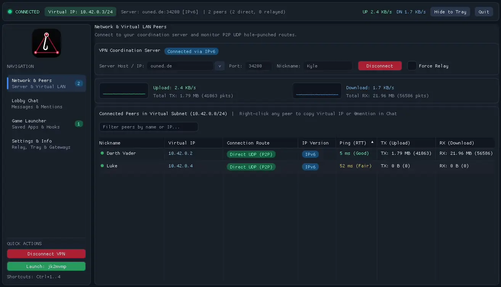
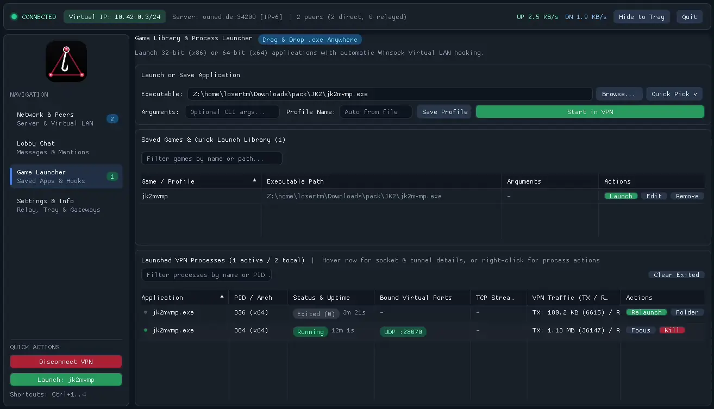

[](https://github.com/ouned/APIVPN/actions/workflows/ci.yml)


**APIVPN** is a 100% native C++20 user-mode virtual LAN (VPN) designed for playing classic and legacy LAN games over the internet **without kernel-mode network drivers** (such as TAP or Wintun) and **without Administrator privileges**.

Instead of installing a virtual OS network adapter, APIVPN intercepts and virtualizes networking and socket API calls directly inside applications launched through the VPN client.

**Warning:**
- This is a vibe-coded weekend project I did for fun.
- Your virus scanner will freak out over this, because of the way it works (hooks & detours).
- There is no traffic encryption, do not use it for serious applications.




> 📖 **Deep dive:** see [`ARCHITECTURE.md`](ARCHITECTURE.md) for the full design — hook engine, virtual TCP multiplexing, hole punching, wire protocols, and the security model. [`TESTING.md`](TESTING.md) covers the test suite.

---

## Table of Contents

- [Key Features](#key-features)
- [Quick Start](#quick-start)
- [Requirements](#requirements)
- [How It Works](#how-it-works)
- [Project Structure](#project-structure)
- [Building](#building)
- [Usage](#usage)
- [Testing](#testing)
- [Security](#security)
- [Troubleshooting](#troubleshooting)

---

## Key Features

- **Zero Drivers / Zero Admin Rights:** Runs entirely in user mode by hooking socket and network adapter APIs in target processes.
- **Full 32-bit (`x86`) & 64-bit (`x64`) Support:** Automatically detects target executable bitness, injects the matching hook library (`apivpn_hook32.dll` or `apivpn_hook64.dll`), and propagates across child processes—even when a 32-bit launcher spawns a 64-bit game binary or vice versa.
- **Complete Protocol Support:**
  - **UDP Unicast** (`SOCK_DGRAM` within `10.42.0.0/24`)
  - **UDP Broadcast & Multicast** (`255.255.255.255`, `10.42.0.255`, and `224.0.0.0/4`) for LAN game lobby discovery
  - **TCP Streams** (`SOCK_STREAM`) with reliable virtual stream multiplexing
- **Direct P2P with UDP Hole Punching + Server Relay Fallback:**
  - Central server coordinates Virtual IP allocation (`10.42.0.2` – `10.42.0.254`), peer discovery, and lobby chat.
  - Clients automatically perform simultaneous UDP hole punching across public and local LAN endpoints for low-latency **Direct P2P** connections.
  - Seamlessly falls back to **Server Relay** if NAT traversal fails or while hole punching is negotiating.
- **Multi-Client Isolation on a Single PC:** Multiple APIVPN clients and multiple instances of the same game can bind to the exact same virtual ports (e.g., port `6112`) on one machine without port conflicts (`WSAEADDRINUSE`).
- **Native Win32 Client GUI & Headless CLI:** Includes an intuitive GUI with server connection controls, live peer status/ping/traffic table, lobby chat, and an application launcher, plus CLI flags for headless automation.
- **Cross-Platform Architecture:** A clean Platform Abstraction Layer (`include/apivpn/platform/`) separates portable socket virtualization (`SocketShimCore`) and routing from OS-specific backends. The coordination server builds and runs natively on **Windows and Linux**; the client/hook layer is Windows-first with a documented `LD_PRELOAD` extension path for Linux (`src/platform/linux/README.md`).

---

## Quick Start

```bat
:: 1. Build the 32-bit and 64-bit Windows targets into .\bin\
build_all.bat

:: 2. Start the coordination & relay server
.\bin\apivpn_server.exe

:: 3. Start the client and connect to the server in the GUI
.\bin\apivpn_client.exe
```

Or launch a game directly and let the client connect, start minimized in the tray, and exit when the game ends:

```bat
.\bin\apivpn_client.exe --server <server-ip> --nick Alice --launch "C:\Path\To\Game.exe"
```

See [Usage](#usage) for the full CLI, and [Building](#building) for MinGW/Linux builds.

---

## Requirements

**Client & hook (Windows only):**
- Windows 10 / 11 (x64 or x86)
- [Visual Studio 2022](https://visualstudio.microsoft.com/) with the **Desktop development with C++** workload (Win32 **and** x64 toolsets), **or** MinGW-w64
- CMake 3.20+ and a C++20 compiler

**Server (Windows or Linux):**
- CMake 3.20+ and a C++20 compiler (GCC 10+ or Clang 12+ on Linux)

**Cross-compiling on Linux / running tests under Wine:**
- MinGW-w64 (`g++-mingw-w64-i686-posix` and `g++-mingw-w64-x86-64-posix`)
- `wine64` (or `wine`) to run the Windows binaries and the integration test suite

On Debian/Ubuntu:
```bash
sudo apt install cmake g++ g++-mingw-w64-i686-posix g++-mingw-w64-x86-64-posix wine64
```

---

## How It Works

APIVPN has three runtime layers: a **hook DLL** injected into each game process, a local **client daemon** that owns the virtual LAN, and a central **coordination & relay server**. The summaries below are an overview — [`ARCHITECTURE.md`](ARCHITECTURE.md) is the authoritative design reference.

- **Loopback socket remapping.** Hooked sockets stay **real OS kernel sockets** bound to `127.0.0.1` on OS-assigned ephemeral ports, which preserves `select()`, `WSAPoll()`, event objects, and overlapped I/O. `bind()`, `sendto()`, `connect()`, `accept()`, `getsockname()`, `getpeername()`, and the adapter/DNS APIs are rewritten so the application sees a `10.42.0.x/24` virtual LAN while traffic is routed through the client daemon. See [ARCHITECTURE.md §4](ARCHITECTURE.md#4-loopback-socket-virtualization).
- **Dual-architecture hooking.** A self-contained x86/x64 inline-detour engine (zero third-party dependencies) plus PE bitness detection injects the matching `apivpn_hook32.dll` / `apivpn_hook64.dll`, and propagates across child processes — even when a 32-bit launcher spawns a 64-bit game. See [ARCHITECTURE.md §3](ARCHITECTURE.md#3-process-injection--cross-bitness-propagation).
- **P2P with relay fallback.** Clients register with the server, exchange candidate endpoints, and perform simultaneous UDP hole punching (IPv4 + IPv6) to reach **Direct P2P** on the lowest-RTT path. Before that succeeds — or if NAT traversal is blocked or keepalives time out — traffic is relayed through the server. See [ARCHITECTURE.md §5](ARCHITECTURE.md#5-wan-transport-discovery-hole-punching--relay).
- **Reliable virtual TCP.** Because peer links are UDP, the client daemon runs a user-space reliable stream engine (segmentation, cumulative ACKs, SACK, RFC 6298 RTT estimation, fast retransmit, and AIMD congestion control) for `SOCK_STREAM` traffic. See [ARCHITECTURE.md §4.3](ARCHITECTURE.md#43-virtual-tcp-stream-multiplexing).

---

## Project Structure

```text
APIVPN/
├── ARCHITECTURE.md                      # Detailed design: hooks, protocols, hole punching, security model
├── TESTING.md                           # How the test suite works and what each test case checks
├── REVIEW.md                            # Code review and fix log (findings, decisions, open items)
├── CMakeLists.txt                       # CMake configuration for x86, x64, and native Linux builds
├── build_all.bat                        # Builds both 32-bit and 64-bit targets into ./bin (Windows)
├── build_mingw.sh                       # Cross-compiles x86/x64 with MinGW-w64 (--test runs the suite under Wine)
├── cmake/                               # MinGW-w64 toolchain files
├── include/apivpn/
│   ├── common/                          # Wire protocol structs, serialization, logger
│   ├── platform/                        # Cross-platform socket, process, and hook interfaces
│   ├── hook/                            # Portable SocketShimCore virtualization engine
│   ├── server/                          # Central coordination, chat, and relay server
│   └── client/                          # Client engine (hole puncher, gateways, GUI controller)
├── src/
│   ├── platform/win32/                  # WinSock2, PE launcher/injector, x86/x64 inline detours
│   ├── platform/linux/                  # POSIX socket backend (native Linux server) + LD_PRELOAD extension point
│   ├── hook/                            # SocketShimCore + Win32 DLL hooks (ws2_32, iphlpapi, kernel32)
│   ├── injector/                        # apivpn_injector32.exe / apivpn_injector64.exe
│   ├── server/                          # apivpn_server implementation (Windows + Linux)
│   └── client/                          # apivpn_client.exe implementation + Win32 GUI
├── third_party/imgui/                   # Dear ImGui (vendored, for the client GUI)
└── tests/
    ├── test_game_app.cpp                # Scriptable app: LAN flows, UDP/TCP APIs, overlapped I/O, adapter/DNS, injection
    └── integration_test_runner.cpp      # End-to-end automated verification suite
```

For the design behind these modules, see [`ARCHITECTURE.md`](ARCHITECTURE.md).

---

## Building

### Build All Targets on Windows (`x86` + `x64`)
Run the included batch script from the repository root:

```bat
build_all.bat
```

This builds both the 32-bit (`build32/`) and 64-bit (`build64/`) targets with a **statically linked MSVC runtime (`/MT`)** (zero dependency on VC++ Redistributable DLLs) and places all binaries side-by-side in `.\bin\`:

| Binary | Architecture | Description |
| :--- | :---: | :--- |
| `apivpn_server.exe` | `x64` | Central coordination, lobby chat, and relay server |
| `apivpn_client.exe` | `x64` | VPN client (Win32 GUI and headless CLI modes) |
| `apivpn_injector64.exe` | `x64` | 64-bit process launcher and DLL injector helper |
| `apivpn_hook64.dll` | `x64` | 64-bit API hook library |
| `apivpn_injector32.exe` | `x86` | 32-bit process launcher and DLL injector helper |
| `apivpn_hook32.dll` | `x86` | 32-bit API hook library |
| `test_game_app64.exe` | `x64` | 64-bit test LAN game application |
| `test_game_app32.exe` | `x86` | 32-bit test LAN game application |
| `integration_test_runner.exe` | `x64` | Automated end-to-end integration test runner |

### Build All Windows Targets on Linux with MinGW-w64 & Run with Wine
You can cross-compile all 32-bit (`x86`) and 64-bit (`x64`) Windows binaries and hook DLLs on Linux using MinGW-w64 (`g++-mingw-w64-i686-posix` and `g++-mingw-w64-x86-64-posix`), and run/test them directly under Wine:

```bash
./build_mingw.sh
```

To build and immediately run the full end-to-end integration test suite under Wine:

```bash
./build_mingw.sh --test
```

Or run individual binaries under Wine:
```bash
wine64 ./bin/apivpn_server.exe --port 34200
wine64 ./bin/apivpn_client.exe
wine64 ./bin/integration_test_runner.exe
```

### Build the Native Linux VPN Server
On Linux (with CMake 3.20+ and a C++20 compiler such as GCC 10+ or Clang 12+):

```bash
cmake -B build -DCMAKE_BUILD_TYPE=Release
cmake --build build -j
./bin/apivpn_server --port 34200
```

---

## Usage

### 1. Start the Server
```bat
.\bin\apivpn_server.exe --port 34200
```
*(If `--port` is omitted, it defaults to `34200` for both TCP control and UDP transport/relay.)*

### 2. Start the Client (GUI Mode)
```bat
.\bin\apivpn_client.exe
```
In the GUI you can:
1. Enter the **Server IP**, **Port** (`34200`), and your **Nickname**, then click **Connect**.
2. View connected peers, their Virtual IPs (`10.42.0.x`), routing mode (`Direct UDP` vs `Relayed`), active endpoint, RTT ping, and packet counters.
3. Toggle **Force Server Relay Mode** at any time to test or force relayed routing.
4. Chat with connected players in the **Lobby Chat** panel.
5. Browse for a 32-bit or 64-bit game executable in the **Application Launcher** panel and click **Start in VPN**.

### 3. Start the Client Directly with a Game (Minimized to Tray & Auto-Exit)
You can launch `apivpn_client.exe` directly with a target game executable (via shortcut, command line, or dragging and dropping an `.exe` onto `apivpn_client.exe`). When launched with a target executable, the client automatically:
1. Connects to your configured VPN server (from `apivpn_client.ini` or `--server`).
2. Starts minimized in the Windows system tray.
3. Launches the target executable inside the virtual LAN.
4. Automatically exits when the game (including any child game processes spawned by a launcher) ends.

```bat
.\bin\apivpn_client.exe "C:\Path\To\Game.exe" -windowed
```
Or using explicit flags:
```bat
.\bin\apivpn_client.exe --server 127.0.0.1 --port 34200 --nick Alice --tray --exit-with-game --launch "C:\Path\To\Game.exe" --launch-args "-windowed"
```
Available flags:
- `<exe_path> [args...]` or `--launch <exe_path>`: Launch a 32-bit or 64-bit executable inside the VPN
- `--launch-args <args>`: Command-line arguments passed to the launched executable
- `--tray` / `--minimized`: Start minimized in the system tray (default when launching a target executable)
- `--no-tray` / `--show-gui`: Show the main GUI window even when launching a target executable
- `--exit-with-game`: Exit APIVPN automatically when the launched game ends (default when launching a target executable)
- `--keep-open`: Keep APIVPN running after the launched game ends
- `--server <ip>`: Server hostname, IPv6, or IPv4 address (auto-connects on startup; defaults to `apivpn_client.ini`)
- `--port <port>`: Server port (default `34200` or `apivpn_client.ini`)
- `--nick <name>`: Player nickname (defaults to `apivpn_client.ini`)
- `--force-relay`: Disable direct P2P and route all traffic via the server relay
- `--headless`: Run without creating a GUI window or tray icon
- `--`: End of client options; the next token is the executable and everything after it goes to the game

Argument rules:
- The first positional token (or the token after `--`) is the game executable, and **every token after it is passed to the game verbatim**, even if it looks like a client flag (`apivpn_client.exe Game.exe -n 4` passes `-n 4` to the game).
- A flag missing its value, an invalid `--port` (must be 1–65535), or an unknown option is an error (exit code 5; a message box in GUI mode).
- A game is only launched once the client is connected and has a Virtual IP. With `--launch`, the client waits up to 30 seconds for the connection; headless mode exits with code 4 if none is established.

---

## Testing

The repository ships an end-to-end integration suite that runs the server, several clients and real 32-/64-bit test apps on one machine:

```bat
.\bin\integration_test_runner.exe
```

See [`TESTING.md`](TESTING.md) for how the suite works, what every test case checks, and how to test the GUI and tray paths by hand.

---

## Security

> **APIVPN is not a privacy or anonymity tool.** It is a user-mode LAN emulator intended for trusted peer groups.

- **Traffic is unencrypted.** Virtual UDP datagrams and virtual TCP segments travel in plaintext on both the direct P2P path and through the server relay. Anyone who can observe the traffic can read it, and an on-path attacker can tamper with it.
- **Direct-path source checks, not cryptography.** The server gives each pair of peers a random shared key; direct hole-punch and keep-alive packets must carry it, and direct data is accepted only from a peer's verified endpoint. This stops off-path hosts and other peers from hijacking a route, but the key travels in plaintext.
- **Unguessable session tokens.** Session tokens and pair keys come from the OS CSPRNG. A disconnected client's Virtual IP is reserved for its session token for 60 seconds.
- **Server resource limits.** Per-IP connection and client caps (loopback exempt), a 10-second deadline to send `ClientHello`, capped per-session send queues (slow readers are disconnected), and rate limits on UDP registration, chat and relayed broadcast traffic.
- **No administrator rights or kernel components.** The client, injector, and hook DLL all run at the target application's privilege level.

See [`ARCHITECTURE.md` §8](ARCHITECTURE.md#8-security--trust-model) for the full trust model and potential hardening paths.

---

## Troubleshooting

| Symptom | Likely cause / fix |
| :--- | :--- |
| Windows Defender / SmartScreen flags `apivpn_injector*.exe` or `apivpn_hook*.dll` | The injector uses `CreateRemoteThread` + `LoadLibraryW`, a common AV heuristic. Add the `bin\` folder to your antivirus allowlist. |
| Client shows **Reconnecting** and never connects | The server is unreachable on the control port (default `34200` TCP). Check the address/port, firewall rules, and that `apivpn_server` is running. |
| Peers appear but traffic stays **Relayed** | UDP hole punching was blocked by NAT/firewall. Allow UDP on the server port, or enable **Force Relay Mode** as a fallback. |
| A game can't find the LAN session | The game must be launched **through** the client (GUI launcher, `--launch`, or dragging the `.exe` onto `apivpn_client.exe`) so the hook DLL is injected. Verify the process appears in the client's process list. |
| **Start in VPN** is greyed out, or a launch fails with "Not connected to a VPN server" | Games are only launched once the client has a Virtual IP. Connect first (with `--launch`, the client connects and launches automatically once connected). |
| Game starts but never sees other players; [DebugView](https://learn.microsoft.com/sysinternals/downloads/debugview) shows `[apivpn-hook] ... failed` lines | A required Winsock hook could not be installed (for example an unsupported function prologue). The hook then virtualizes nothing rather than half of the API, so the game runs on the real network only. Please report the game and the logged function names. |
| Two instances of the same game conflict | Use separate APIVPN clients with different nicknames; virtual-port and named-object isolation is automatic per client. |
| `build_mingw.sh --test` can't run the tests | Install `wine64` — the integration runner and test game binaries are Windows executables. |
| GUI doesn't start on a headless / CI machine | Pass `--headless` to run without a window or tray icon. |

For deeper issues, the integration test suite (`integration_test_runner.exe`) is the fastest way to isolate a component: each test owns a fresh server and its own clients, so one failure never blocks the rest.
