# Testing APIVPN

This document explains how the automated test suite works, how to run it, and what each of its test cases checks. It also lists the parts of APIVPN that are **not** covered automatically and how to test them by hand.

---

## Table of Contents

- [At a Glance](#at-a-glance)
- [Running the Tests](#running-the-tests)
- [How the Suite Works](#how-the-suite-works)
  - [Process Layout](#process-layout)
  - [Anatomy of a Test](#anatomy-of-a-test)
  - [Fixture and Helpers](#fixture-and-helpers)
  - [Fault-Injection Knobs](#fault-injection-knobs)
  - [The Scriptable Test App (`test_game_app`)](#the-scriptable-test-app-test_game_app)
- [Test Catalog](#test-catalog)
  - [1. Resolution and Pure Logic](#1-resolution-and-pure-logic)
  - [2. Client–Server Lifecycle](#2-clientserver-lifecycle)
  - [3. Three-Peer Topologies](#3-three-peer-topologies)
  - [4. Hole Punching and Routing](#4-hole-punching-and-routing)
  - [5. Virtual TCP](#5-virtual-tcp)
  - [6. UDP, Process Propagation and Legacy Stacks](#6-udp-process-propagation-and-legacy-stacks)
- [Writing a New Test](#writing-a-new-test)
- [Flakiness and Debugging](#flakiness-and-debugging)
- [Not Covered: Manual Testing](#not-covered-manual-testing)

---

## At a Glance

| | |
| :--- | :--- |
| **Kind** | End-to-end integration tests (plus one pure-logic test) |
| **Runner** | `integration_test_runner.exe` (x64), source `tests/integration_test_runner.cpp` |
| **Test app** | `test_game_app32.exe` / `test_game_app64.exe`, source `tests/test_game_app.cpp` |
| **Runtime** | Roughly 1–2 minutes on a normal Windows machine; longer under Wine |
| **Requirements** | Windows 10/11 (or Wine with 32-bit WoW64 support), loopback IPv4 **and** IPv6 |
| **Network** | Loopback only; nothing leaves the machine |
| **CI** | `windows-test` job in `.github/workflows/ci.yml` (Wine, 15-minute bound) |

Everything runs on one machine: the runner hosts a real `VpnServer` and several real `VpnClient` instances inside its own process. It then launches real 32-bit and 64-bit test executables *through* those clients, so the hook DLL is injected exactly as it would be into a game.

---

## Running the Tests

### On Windows

```bat
build_all.bat
.\bin\integration_test_runner.exe
.\bin\integration_test_runner.exe udp_      :: run tests whose name contains "udp_"
```

### Cross-built on Linux, run under Wine

```bash
./build_mingw.sh --test        # build x86 + x64 with MinGW-w64, then run the suite under Wine
```

Wine needs the 32-bit runtime for the cross-bitness and DirectPlay tests (`wine32:i386` on Ubuntu). The suite is headless, so no display is required.

### Output

```text
============================================================
 APIVPN Integration Test Suite (53 tests)
============================================================
[1/53] host_and_ip_resolution............... PASS  (0 ms)
[2/53] client_server_connect_ipv4........... PASS  (23 ms)
...
[25/53] tcp_half_close...................... FAIL  (20412 ms)
      reason: host report: FAIL: tcp-host only 0/1 connections completed; first error: H recv failed (no half-closed stream)
      report kept: C:\...\bin\report_5124_tcp_half_close_hc_host.txt
...
------------------------------------------------------------
 PASSED: 52   FAILED: 1   TOTAL: 53   (73412 ms)
------------------------------------------------------------
 1 TEST(S) FAILED
============================================================
```

- **Exit code:** `0` if every test passed, `1` otherwise (also `1` if the network stack cannot be initialized).
- **Failure reason:** printed under the failing test, taken from the `CHECK` that failed.
- **Report files:** each launched test app writes its result to `bin\report_<runnerPID>_<test>_<name>.txt`. They are deleted when the test passes and **kept** (and listed) when it fails. The runner PID in the name lets two suite runs coexist.
- **Logging:** the VPN stack's own log output is switched off so the report stays readable. Output is unbuffered, so a hang or crash still leaves a usable log in CI.

---

## How the Suite Works

### Process Layout

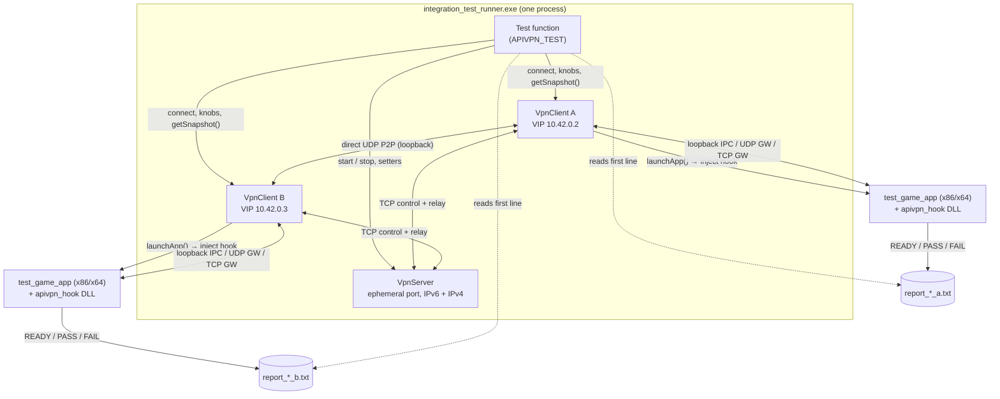

A test app has no idea it is being tested. It uses ordinary Winsock calls (`bind(0.0.0.0:6112)`, `sendto(10.42.0.255)`, `connect(10.42.0.3:6112)`) and only sees the virtual LAN. That is what makes the suite an end-to-end test of the hook, the client daemon and the server together.

### Anatomy of a Test

Most tests follow the same shape: start a server, connect two or three clients, wait for the topology you need, launch a *host* app, wait until it signals `READY`, launch the *joiner* app, then wait for both apps and check their reports.

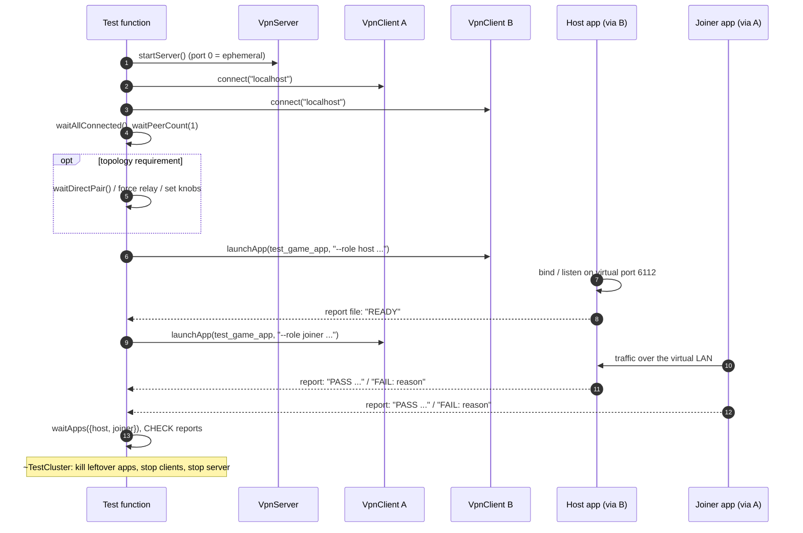

The `READY` handshake replaces the fixed sleeps the suite used to have. A host writes `READY` to its report as soon as it has bound or is listening, and the final `PASS`/`FAIL` line overwrites it. As a second safety net, joiners retry `connect()` on a fresh socket for up to 5 s with a 100 ms back-off.

### Fixture and Helpers

| Helper | What it does |
| :--- | :--- |
| `APIVPN_TEST(name)` | Defines and registers a test. Tests run in the order they appear in the file. |
| `CHECK(cond, msg)` | On failure, records `msg` as the failure reason and returns `false` from the test. |
| `TestCluster` | Per-test fixture: one `VpnServer` plus any number of `VpnClient`s. `connect()` creates a client and connects it immediately. `addClient()` creates one without connecting, so knobs can be set first, and `connectClient(i)` connects it later. Its destructor reaps every app the test launched, then stops the clients, then the server. This happens even when a `CHECK` returned early. |
| `waitUntil(pred, ms)` | Polls a predicate every 25 ms until it is true or the timeout expires. |
| `waitConnected` / `waitAllConnected` | Wait until client(s) have a VIP. |
| `waitPeerCount(n)` | Wait until **every** client sees exactly `n` peers. |
| `waitDirectPair(a, b, v6)` | Wait until both sides see each other on `DirectP2P` over IPv6 (or IPv4). |
| `waitDirectPairAny(a, b)` | Same, any IP family. |
| `launchAppPid(client, exe, args, handle)` | Launches a test app through a client, records its PID and report path for cleanup, and deletes any stale report first. |
| `waitReady(handle)` | Waits until the app's report says `READY` (or `PASS`). |
| `waitApps({...}, ms)` | Waits for **all** listed apps against one deadline. Unlike chaining `waitApp() && waitApp()`, it never short-circuits, so one timeout cannot leave another app unwaited. |
| `reapLaunchedApps()` | Terminates still-running apps **and their descendants** (e.g. the cross-bitness child), then waits for them to exit. |
| `appPath("32"/"64")`, `reportPath(name)` | Paths to the test app binaries and per-run report files in `bin\`. |

### Fault-Injection Knobs

`VpnClient` exposes test hooks that simulate bad networks or shrink timers so the suite can exercise failure paths in seconds instead of minutes:

| Knob | Used by |
| :--- | :--- |
| `setForceRelay(bool)` / `setForceRelayForPeer(vip, bool)` | Relay-only routing, mixed routes, route switch mid-transfer |
| `setDisableIpv6P2P(bool)` | IPv4 fallback and upgrade |
| `setSimulateHolePunchBlocked(bool)` | Hole-punch timeout/retry, automatic direct-to-relay fallback |
| `setSimulateSilentDrop(bool)` | Server inactivity timeout |
| `setSimulatePacketLossPercent(n)` | SACK and fast retransmit under loss |
| `setSimulateReorderPercent(n)` / `setSimulateDuplicatePercent(n)` | Reordering and duplication |
| `setSimulateBandwidthFluctuation(bool)` | Congestion-window adaptation |
| `setTunnelKeepAliveIntervalUs`, `setDirectKeepAliveTimeoutUs`, `setHolePunchTimeoutUs`, `setHolePunchRetryIntervalUs`, `setTcpTunnelKeepAliveIntervalUs`, `setTcpTunnelIdleTimeoutUs`, `setServerTimeoutUs`, `setReconnectIntervalUs` | Timer-driven behaviour in test time |

On the server side: `setMaxClients(n)` and `setPeerTimeoutUs(us)`. The per-IP limits (`setMaxConnectionsPerIp`, `setMaxClientsPerIp`) exempt loopback, so the suite never hits them.

### The Scriptable Test App (`test_game_app`)

One small executable plays every "game" role. It is built for both x86 and x64. Its first report line is what the runner checks.

| Invocation | Behaviour | Report on success |
| :--- | :--- | :--- |
| `--role host` / `--role joiner` (*basic*) | A full mini LAN game, see [`tcp_basic_p2p_udp_and_stream`](#tcp_basic_p2p_udp_and_stream) | `PASS arch=x64 role=joiner vip=10.42.0.x bulk_4MB=...` |
| `--spawn-child <exe> <role>` | Starts `<exe> --role <role>` with plain `CreateProcessA` and returns its exit code (tests hook propagation) | Written by the child |
| `--dplay --role host\|joiner` | A DirectPlay 4 session, see [`directplay_legacy_stack`](#directplay_legacy_stack) | `PASS dplay role=...` |
| `--scenario tcp --role host\|joiner --mode M` | Virtual TCP exchange (modes below) | `PASS tcp-host conns=N` / `PASS tcp-joiner conns=N mode=M` |
| `--scenario udp-recv --port P --token T --expect N --timeout-ms MS` | Counts datagrams that start with `T` | `PASS recv=<count>` |
| `--scenario udp-send --port P --dst IP --token T --count N` | Sends `T` to `IP:P` N times (40 ms apart) | `PASS sent=<count>` |
| `--scenario udp-large --role host\|joiner --size-kb K` | One large datagram plus an ack | `PASS udp-large size=<bytes>` |
| `--scenario udp-api --role host\|joiner --dst IP` | `WSASocketA/W`, implicit bind, `WSAConnect`, `WSASend/WSARecv`, `send/recv`, `WSARecvFrom/WSASendTo` | `PASS udp-api` |
| `--scenario udp-edge --role host\|joiner --dst IP` | `MSG_PEEK`, truncation (`WSAEMSGSIZE`/`MSG_PARTIAL`), multicast | `PASS udp-edge` |
| `--scenario udp-wait --role host\|joiner --dst IP` | `WSAPoll`, `WSAEventSelect`, `WSAAsyncSelect` | `PASS udp-wait` |
| `--scenario adapter-dns` | `getaddrinfo`, `GetAdaptersAddresses`, `SIO_GET_INTERFACE_LIST` and the existing DNS/adapter APIs | `PASS adapter-dns vip=...` |
| `--scenario udp-overlapped --role host\|joiner --dst IP` | Six overlapped UDP ping-pong rounds, one per completion API | `PASS udp-overlapped rounds=6` |
| `--scenario udp-overlapped-edge --role host\|joiner --dst IP` | Multiple outstanding receives, IOCP batch, truncation, `fWait=TRUE` | `PASS udp-overlapped-edge` |
| `--scenario spawn-w --child-exe E --child-report R` | `CreateProcessW`, custom env, `CREATE_SUSPENDED`, child hook activation | `PASS spawn-w` |
| `--scenario spawn-fail --child-exe E --child-report R` | Invalid `APIVPN_BIN_DIR`; injection must fail closed | `PASS spawn-fail` |
| `--scenario env-check --token T` | Child-side check of `APIVPN_*`, custom env and explicit virtual bind | `PASS env-check vip=...` |

Other options: `--port`, `--conns` (connections per destination), `--expect` (connections the host must serve), `--size-kb`, `--delay-ms` (joiner in mode `F`, host in mode `H`), `--dst` / `--dsts` (comma-separated targets), `--child-exe`, `--child-report`, `--sequential`, and `--report <file>`.

**TCP modes.** Every TCP connection starts with a 16-byte handshake (`AVTEST01`, mode, size) that the host echoes. Data uses a deterministic byte pattern, so corruption, loss, duplication or reordering is caught byte by byte.

| Mode | Host side | Joiner side | Proves |
| :---: | :--- | :--- | :--- |
| `B` bulk | Streams `size` bytes, waits for `OK` | Verifies the pattern, sends `OK` | Reliable in-order delivery |
| `C` concurrent | Same as `B`, one thread per connection | N connections in parallel | Tunnel multiplexing |
| `D` duplex | Sends and receives `size` bytes simultaneously | Same | Full-duplex streams |
| `H` half-close | Reads `size` bytes, stays silent for `--delay-ms`, then replies with `size` bytes | Sends, then `shutdown(SD_SEND)`, then reads the reply | FIN propagation with the other direction still open |
| `F` flow | Streams `size` bytes | Sleeps `--delay-ms` before reading | Receive window and back-pressure |
| `A` abort | Waits for `recv() <= 0` | Sets `SO_LINGER {1,0}`, sends 5 bytes, closes | RST/abort propagation |
| `I` idle | Sends nothing; waits up to 20 s for the connection to end | Sends nothing; passes only if `recv()` fails with `WSAECONNRESET`/`WSAECONNABORTED`, fails on EOF | A torn-down tunnel surfaces as a reset |
| `N` non-blocking | Same as `B` | Sets `FIONBIO`, connects, waits for writability, restores blocking mode | Non-blocking virtual connect |
| `refused` | No host | One `connect()` that must **fail** | Connect to a port nobody listens on |

With `--sequential`, the host accepts, serves and closes one connection before accepting the next. The joiner waits for that close before reconnecting.

---

## Test Catalog

Unless noted otherwise, clients connect to `localhost`, which resolves to IPv6 first. VIPs are handed out in connection order: A = `10.42.0.2`, B = `10.42.0.3`, C = `10.42.0.4`. The game port is `6112`.

### 1. Resolution and Pure Logic

#### `host_and_ip_resolution`
Tests the address helpers without any networking.
- `splitHostPort` handles `[::1]:45000`, a bare `::1` (default port kept) and `localhost:39999`; `formatHostPort` brackets IPv6.
- `parseIpString` parses IPv6 and IPv4 literals with ports and recognises loopback.
- `resolveHost("localhost")` returns at least two endpoints, IPv6 **first**, with an IPv4 fallback.

#### `seq_wraparound_comparison`
A pure unit test of the RFC 1982 serial-number helpers used by the virtual TCP engine (`seqLess` / `seqGreater`). It checks:
- ordering across the 2³² wrap (`0xFFFFFFFF` < `0x1`);
- plain forward ordering, and equal values comparing neither way;
- a receive window that straddles the wrap: acked `0xFFFFFFFE`, missing `0xFFFFFFFF`, out-of-order `0x0`.

### 2. Client–Server Lifecycle

#### `client_server_connect_ipv4`
Connects one client to `127.0.0.1`. The snapshot must show an IPv4 server connection and VIP `10.42.0.2`.

#### `client_server_connect_ipv6_preference`
The server must have an IPv6 listener. One client connects to `localhost` and one to `[::1]`. Both must end up on IPv6, with VIPs `.2` and `.3`.

#### `lobby_chat_two_peers`
A and B each send one chat message. Both chat histories must reach at least two messages.

#### `unreachable_server_sets_reconnecting`
Starts a server only to learn a free port, then stops it. `connectToServer` to that port must return `false` and leave the client in the *reconnecting* state, not stuck or crashed.

#### `server_max_clients_capacity`
With `setMaxClients(2)`:
1. A and B connect.
2. A third client is rejected and gets no VIP.
3. B disconnects, and the server releases the slot.
4. The rejected client keeps retrying (300 ms interval) and must join on its own.

#### `malformed_frame_does_not_kill_server`
Two raw TCP connections attack the control port: one sends 16 bytes of garbage (bad magic), the other a valid header announcing a ~4 GB payload. Afterwards a normal client must still connect and receive `10.42.0.2`. This proves only the offending sessions were dropped.

#### `server_restart_reconnect`
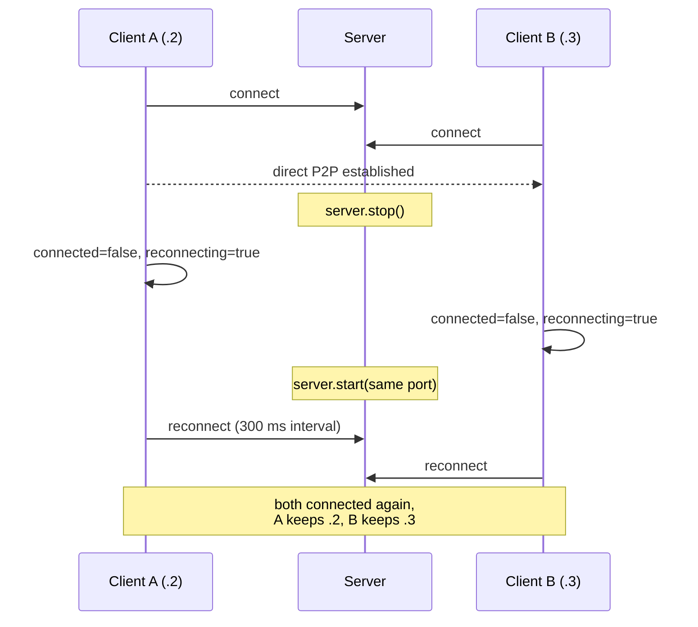
The restarted server has no memory of old sessions, so the VIPs come back through each client's preferred-VIP request. Because the new server also issues new pair keys, existing direct tunnels are reset on reconnect, which is expected.

#### `server_peer_inactivity_timeout`
The server peer timeout is set to 1.2 s and B is told to go silent (`setSimulateSilentDrop`). The server must time B out (connected count 1), and A must stay connected with an empty peer list.

### 3. Three-Peer Topologies

All of these connect A, B and C. Unless stated otherwise, the client routes are left alone: direct P2P where hole punching succeeds, relay until then.

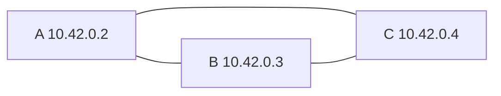

#### `three_peer_topology`
VIPs must be exactly `.2`, `.3`, `.4`, every client must see exactly two peers, and A must list both B and C.

#### `lobby_chat_three_peers`
Each client sends one message. All three histories must reach three messages.

#### `udp_broadcast_fanout_three_peers`
B and C run `udp-recv` on port 6112 for the token `BCAST`. A sends five datagrams to the subnet broadcast `10.42.0.255:6112`. B and C must each receive at least one.

#### `udp_unicast_isolation_three_peers`
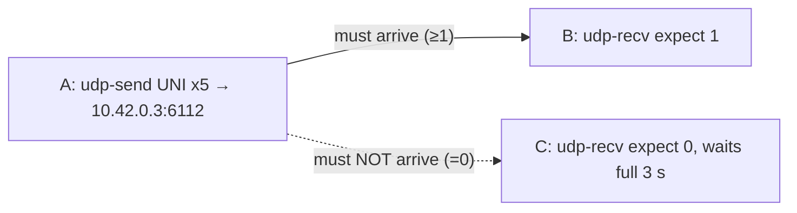
B must receive at least one; C must receive **exactly zero**. This guards against a unicast being fanned out like a broadcast.

#### `tcp_mesh_three_peers`
B and C each host a bulk TCP listener (128 KB). A's joiner connects to **both** (`--dsts B,C`). All three apps must pass.

#### `mixed_route_modes_three_peers`
A pins C onto the relay (`setForceRelayForPeer(C)`) while B stays direct. The test waits until A shows B as `DirectP2P` and C as `ServerRelay`, then sends UDP from A to B and from A to C. Both must arrive, so a single client can mix routes per peer.

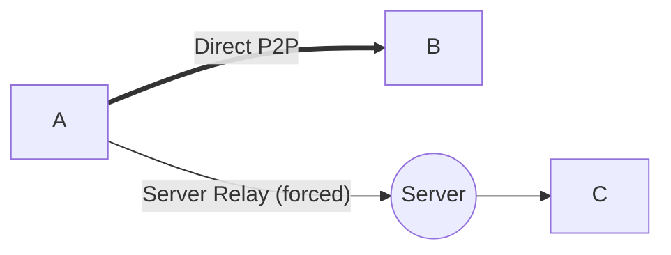

### 4. Hole Punching and Routing

#### `holepunch_prefers_ipv6_direct`
Two clients must settle on `DirectP2P` over **IPv6** on both sides within 12 s.

#### `holepunch_ipv4_fallback_and_upgrade`
IPv6 P2P is disabled on both clients, so they must reach direct **IPv4**. When it is re-enabled, both must upgrade to direct **IPv6**.

#### `tunnel_keepalive_interval`
The keep-alive interval is set to 500 ms **before** connecting. After a settled direct IPv6 path, the test measures a ~3 s window against a baseline:
- each side sends at most `window/500 + 1` and at least `window/500/2` keep-alives;
- both sides **receive** keep-alives.

This catches both a dead keep-alive timer and one firing faster than configured.

#### `holepunch_timeout_then_retry_recovers`
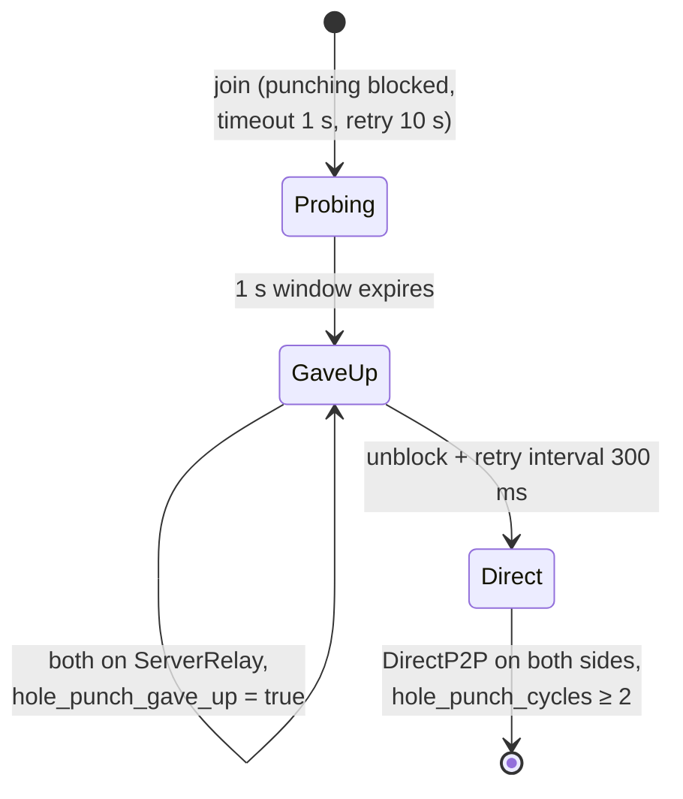
1. Shortly after joining, A must be actively probing (`punch_probes_sent > 0`, not given up).
2. After the injected 1 s window, both must give up and sit on the relay.
3. Once unblocked with a short retry interval, the periodic retry must reach `DirectP2P` on both sides, after at least two punch cycles.

#### `spoofed_punch_does_not_hijack_route`
Security regression test for the direct-path pair keys.
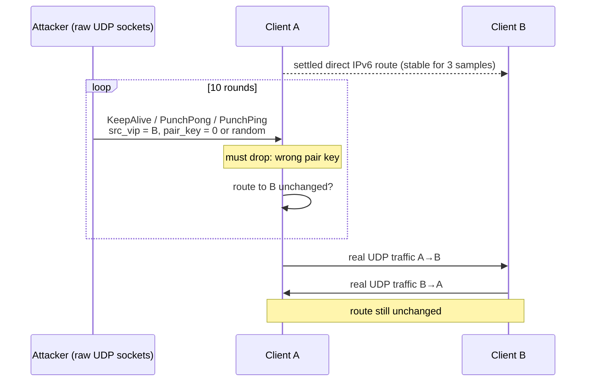
- The test collects every UDP endpoint B knows for A and floods all of them from two fresh sockets (IPv4 and IPv6).
- After every round, A's route to B must still be `DirectP2P` with the original endpoint. If it moved, the message says whether it moved to the attacker's port.
- Real traffic must then flow in both directions. The test runs one direction at a time, because sender and receiver both bind port 6112.

#### `automatic_direct_to_relay_fallback`
Two clients first settle on direct P2P. The test then drops incoming punch/keep-alive packets, stops direct keep-alives and shrinks `setDirectKeepAliveTimeoutUs` to 1 s. Both sides must downgrade to `ServerRelay` within 6 s, and a UDP exchange must still work over the relay. Hole punching stays blocked, so the route cannot silently upgrade again during the test.

#### `server_outage_keeps_direct_traffic`
After a direct P2P route is established, the server is stopped. Both clients must enter `reconnecting` while keeping their VIPs and their direct route. A UDP receiver launched before the outage and a sender launched **after** the outage must still exchange traffic over the direct path. This covers the server-outage continuity rule in §5 of `ARCHITECTURE.md`.

### 5. Virtual TCP

Unless noted, these use two clients, a host app on B and a joiner app on A connecting to `B:6112`. The two "basic" game tests are the exception: there the host runs on A.

#### `tcp_basic_p2p_udp_and_stream`
The "mini LAN game" end-to-end test. It waits for direct P2P first. The host (via A) is 64-bit and the joiner (via B) is **32-bit**.
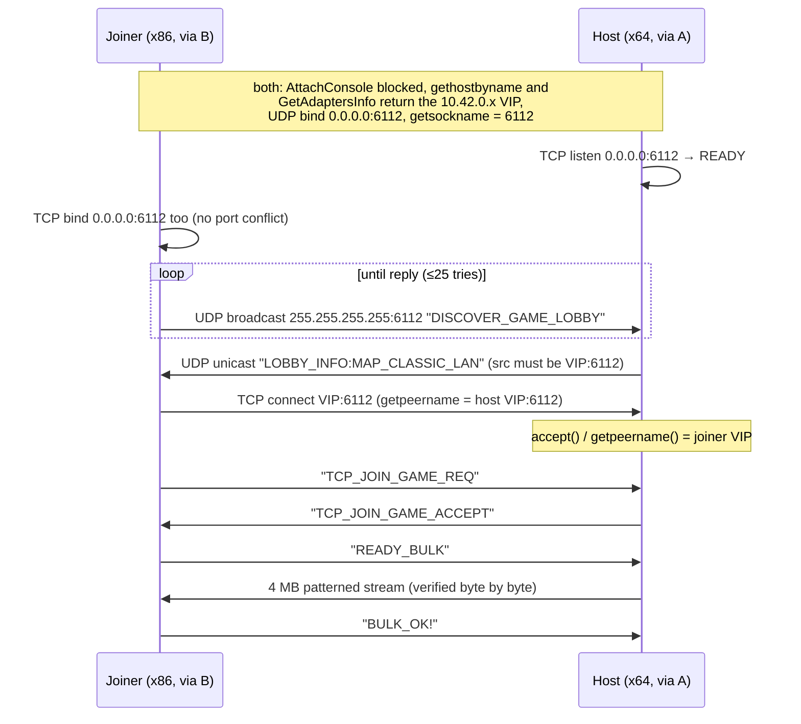

#### `tcp_basic_relay_fallback`
The same game flow with both clients forced onto the **server relay**, and the bitness swapped (host x86 via A, joiner x64 via B).

#### `tcp_concurrent_connections`
Mode `C`: four simultaneous connections of 1 MB each. The host must serve all four.

#### `tcp_full_duplex`
Mode `D`: both sides send and receive 1 MB at the same time.

#### `tcp_half_close`
Mode `H`:
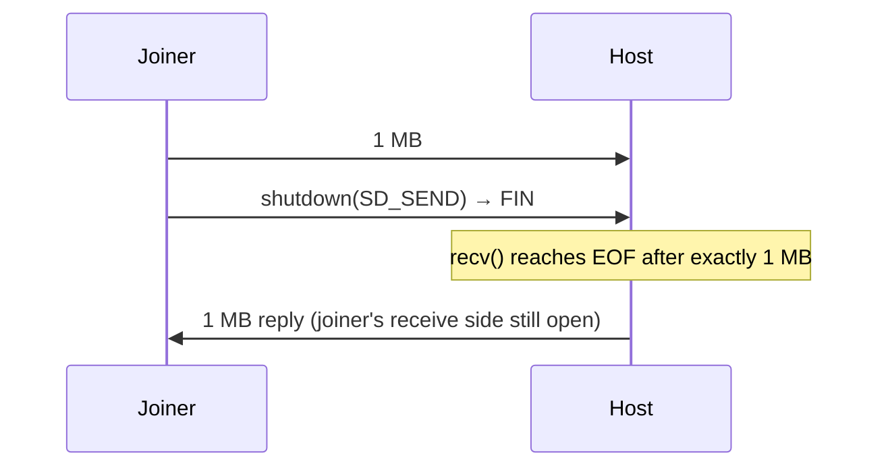

#### `tcp_abortive_close`
Mode `A`: the joiner sets `SO_LINGER {1,0}`, sends five bytes and closes. The host must see `recv()` return `0` or an error (reset) within 10 s.

#### `tcp_connect_refused`
Nothing listens on virtual port 6113 on B. A single `connect()` to `B:6113` must **fail**, so the negative path works and does not hang.

#### `tcp_nonblocking_connect`
The joiner sets `FIONBIO`, calls `connect()` to the host VIP, handles either an inline success or `WSAEWOULDBLOCK` + writable socket, verifies `SO_ERROR`, restores blocking mode and runs the normal bulk handshake. This covers the hook's non-blocking loopback-connect special case.

#### `tcp_flow_control_backpressure`
Mode `F`, 2 MB: the joiner waits 700 ms before it starts reading. The sender must respect the advertised window and the transfer must still complete intact.

#### `tcp_reorder_and_duplicate`
Both clients reorder 25 % and duplicate 10 % of frames. A 1 MB bulk transfer must arrive intact, exactly once and in order.

#### `tcp_packet_loss_sack_recovery`
Both clients drop 5 % of frames during a 4 MB transfer. Besides both apps passing, the snapshot counters must show:
- at least 20 simulated drops;
- retransmissions (fast plus RTO) ≥ drops;
- at least one SACK event;
- at least one congestion-window back-off.

#### `tcp_bandwidth_fluctuation`
Simulated bandwidth swings during a 4 MB transfer. Both apps must pass, tail drops must have occurred, and the congestion window must have scaled both **up** and **down**.

#### `tcp_route_switch_mid_transfer`
A 4 MB transfer starts over direct P2P. After 300 ms the sender is forced onto the relay mid-stream, and the stream must complete intact.

#### `tcp_tunnel_cleanup_after_close`
After a successful 128 KB transfer, both clients' `tcp_tunnel_count` must drop to **0** within 8 s, so closed tunnels are reclaimed.

#### `tcp_listener_survives_accepted_close`
Regression test for a bug where closing an accepted socket unregistered its listener, so every later connection to that port was refused.
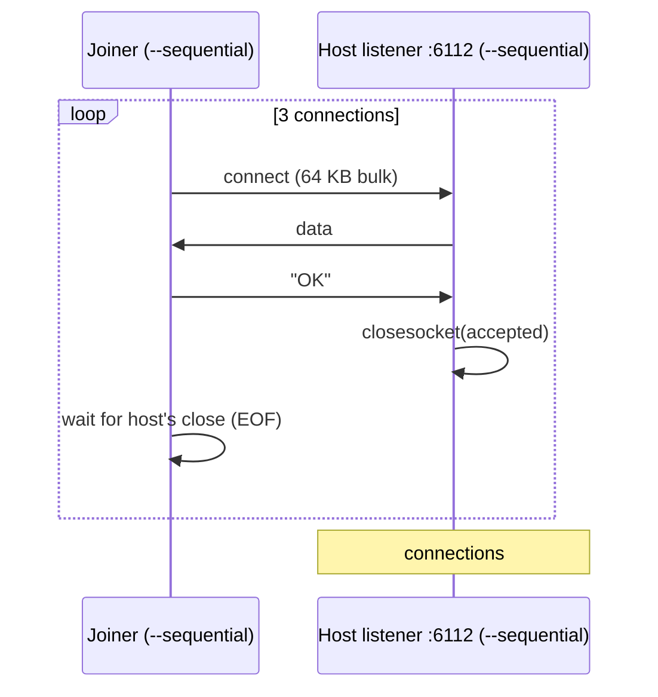

#### `tcp_tunnel_idle_timeout_reaps_dead_peer`
The tunnel liveness timers are shrunk to a 300 ms probe and a 1.5 s idle timeout.
1. A mode-`F` transfer opens a tunnel, with the joiner delaying its reads by 6 s, so the tunnel stays open but idle.
2. After 2.5 s (more than the idle timeout), **both** tunnels must still exist, because the liveness probes keep a healthy idle tunnel alive.
3. B is then stopped abruptly. A must reap its tunnel within 8 s instead of leaking the socket and its receive buffer.

When B stops, it also leaves the server's peer list, which makes A abort the tunnel right away. Either that or the idle timeout satisfies the test.

#### `tcp_idle_timeout_resets_app`
Checks what the **app** sees when the idle timeout fires, which the previous test does not.
- A uses a 300 ms probe and a 1.5 s idle timeout. B stays connected and in the peer list but probes only once an hour, so the idle timeout is the only thing that can end the tunnel.
- Both apps run mode `I` and send nothing after the handshake.
- The joiner on A must see `recv()` fail with a reset; an orderly EOF fails the test, because it would look like a complete stream. A's `tcp_tunnel_count` must then drop to 0.

#### `tcp_half_close_survives_idle_timeout`
Checks that a healthy half-closed tunnel is not reaped by the idle timeout.
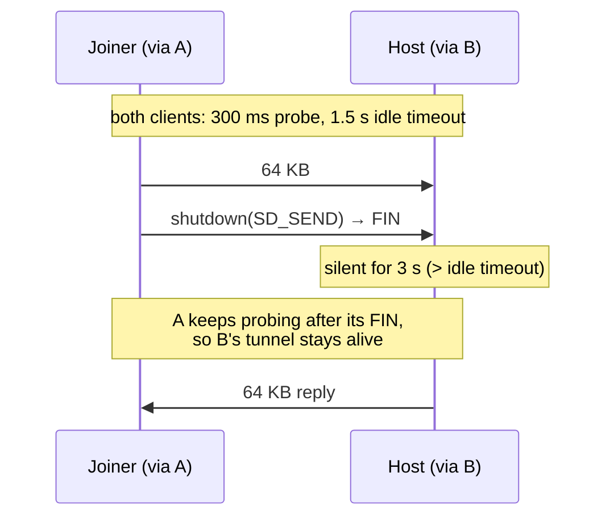
Both apps must pass. Before the fix, A stopped probing once it had sent its FIN, so B reaped the tunnel during the host's silence and the reply never arrived.

### 6. UDP, Process Propagation and Legacy Stacks

#### `udp_overlapped_io`
Both apps bind a virtual UDP socket to `0.0.0.0:6112` and exchange six request/reply rounds. Both the send and the receive of each round use the same completion mechanism, so a missing fix-up cannot be masked by another completion path:

| Round | Completion API | Path exercised |
| :---: | :--- | :--- |
| 1 | `WSAGetOverlappedResult` | event-based overlapped I/O |
| 2 | Completion routine | APC callback thunk |
| 3 | `GetOverlappedResult` | kernel32/kernelbase result query |
| 4 | `GetOverlappedResultEx` | timed result query |
| 5 | `GetQueuedCompletionStatus` | IOCP dequeue |
| 6 | `GetQueuedCompletionStatusEx` | batched IOCP dequeue |

Every round checks the reported byte count, the payload (the 16-byte loopback header must be stripped), and the virtual source address/port returned in `lpFrom`. The payload sizes differ per round, and the reply is larger than the request, so an off-by-16 or a stale `InternalHigh` is caught.

#### `udp_api_surface`
Exercises the UDP API variants that are easy to miss:
- host: `WSASocketW` + `WSARecvFrom`/`WSASendTo`;
- joiner: `WSASocketA` with **no explicit `bind()`**, `WSAConnect`, then `WSASend`/`WSARecv` and `send`/`recv` on the connected datagram socket.

The joiner's `getsockname()` must report a `10.42.0.x` virtual address and a non-zero implicit virtual port. The host checks the virtual source address and the two request/reply rounds.

#### `udp_edge_semantics`
The host checks Winsock edge behavior on virtual UDP sockets:
- `recvfrom(..., MSG_PEEK)` returns the payload and virtual source without consuming it, and the next normal `recvfrom` sees the same datagram;
- a datagram larger than the receive buffer makes `recvfrom` fail with `WSAEMSGSIZE`;
- the same truncation through `WSARecvFrom` fails with `WSAEMSGSIZE` and sets `MSG_PARTIAL`;
- a send to multicast `239.255.0.1` is delivered like broadcast.

#### `relay_broadcast_multicast_fanout`
Three clients are forced onto `ServerRelay`. A sends to the subnet broadcast `10.42.0.255`, then to multicast `239.255.0.1`; both B and C must receive each datagram through the server relay. This covers the relay's broadcast/multicast fan-out path separately from the direct-path fan-out test.

#### `udp_wait_models`
The host receives three datagrams through three different readiness models:
- `WSAPoll` with `POLLRDNORM`;
- `WSAEventSelect` + `WSAWaitForMultipleEvents` + `WSAEnumNetworkEvents`;
- `WSAAsyncSelect` with a message-only window and `MsgWaitForMultipleObjects`.

The joiner sends one token per model with a short gap.

#### `adapter_dns_virtualization`
One hooked app checks every adapter/DNS surface:
- `gethostbyname` and `getaddrinfo` on the local hostname return the VIP;
- `GetAdaptersInfo` returns VIP `10.42.0.x`, mask `255.255.255.0`, gateway `10.42.0.1`;
- `GetAdaptersAddresses` returns the virtual IPv4 address with prefix length 24;
- `WSAIoctl(SIO_GET_INTERFACE_LIST)` returns the VIP, broadcast `10.42.0.255` and netmask `255.255.255.0`.

#### `udp_overlapped_edge_cases`
Extends the overlapped test with:
- two outstanding `WSARecvFrom` operations on one socket, both completed and fixed up through `GetQueuedCompletionStatusEx`;
- a truncated overlapped receive that must fail with `WSAEMSGSIZE` and set `MSG_PARTIAL` (this caught a missing fix-up for gateway datagrams);
- `WSAGetOverlappedResult(..., fWait=TRUE)` completing when the final datagram arrives.

#### `process_injection_createprocessw`
A 64-bit parent launches a 64-bit child with `CreateProcessW`, a caller-supplied Unicode environment block and `CREATE_SUSPENDED`. The test verifies that the child has not run before `ResumeThread`, that the custom marker variable and `APIVPN_*` variables are merged into the child environment, that the hook DLL is loaded, and that the child can bind an explicit `10.42.0.x:6112` virtual address.

#### `process_injection_fail_closed`
The parent points `APIVPN_BIN_DIR` at a non-existent directory and calls `CreateProcessW`. Injection must fail, the child must be terminated, `CreateProcessW` must return `FALSE` with `ERROR_ACCESS_DENIED`, and no child report may appear. This proves the fail-closed path instead of running a child un-hooked on the real network.

#### `udp_large_datagram`
The joiner sends one 6 KB datagram, larger than any Ethernet MTU, so it is encapsulated as one large virtual UDP frame. It resends every 500 ms until the host acks `LARGE_OK`. The host must receive it with the exact length and an intact byte pattern.

#### `cross_bitness_child_spawn`
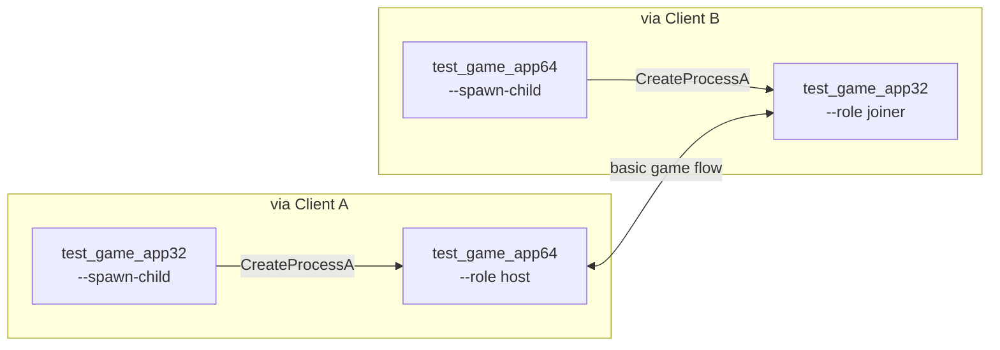
Each parent only spawns a child of the **other** bitness with plain `CreateProcessA`. The children run the full basic game flow, which only works if the hook's `CreateProcess` detour injected the matching 32-bit or 64-bit hook DLL into each child.

#### `directplay_legacy_stack`
Both sides are 32-bit apps using the real DirectPlay 4 COM objects (`dplayx.dll`, `dpwsockx.dll`, `dplaysvr.exe`) with the TCP/IP service provider:
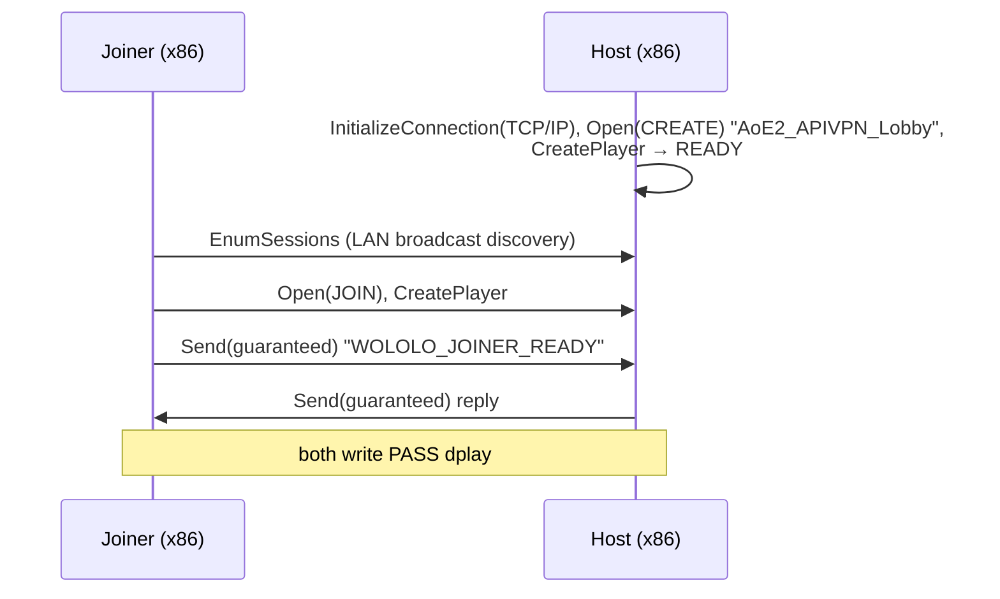
This covers DirectPlay's broadcast session discovery, its helper process, and the per-instance renaming of named kernel objects, all through the hook. The host gets 15 s to become ready.
